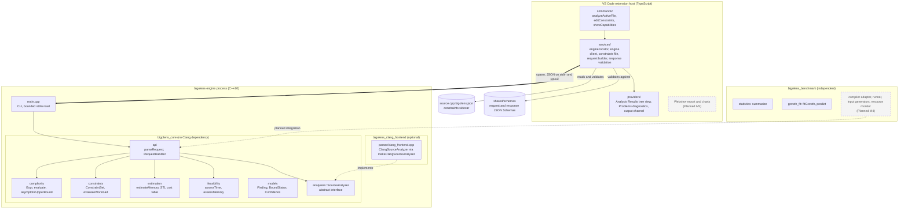
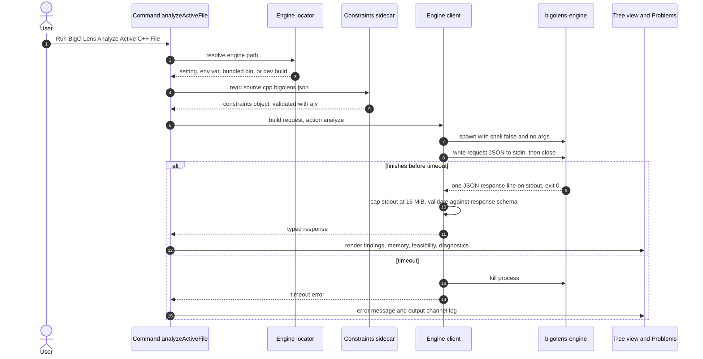
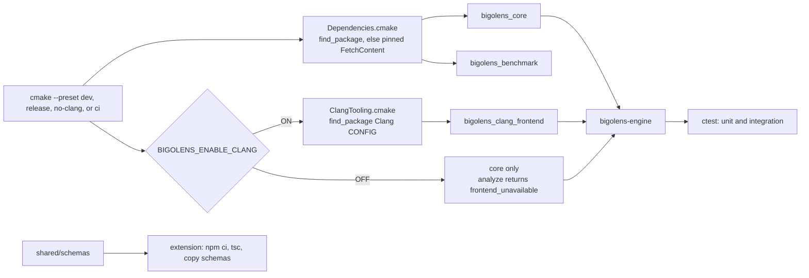
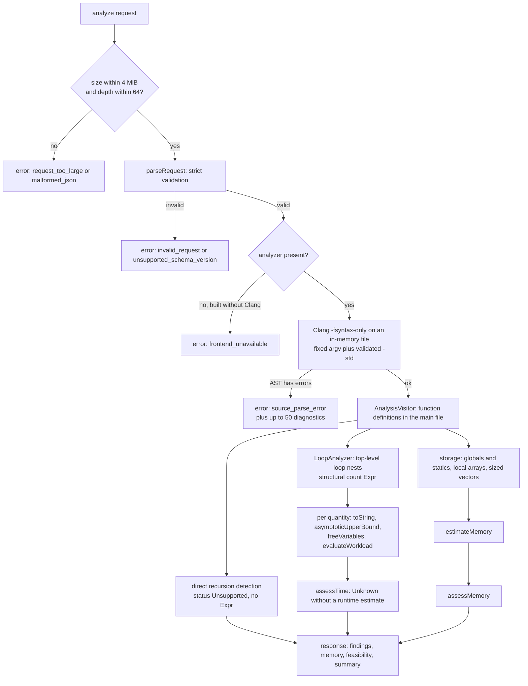
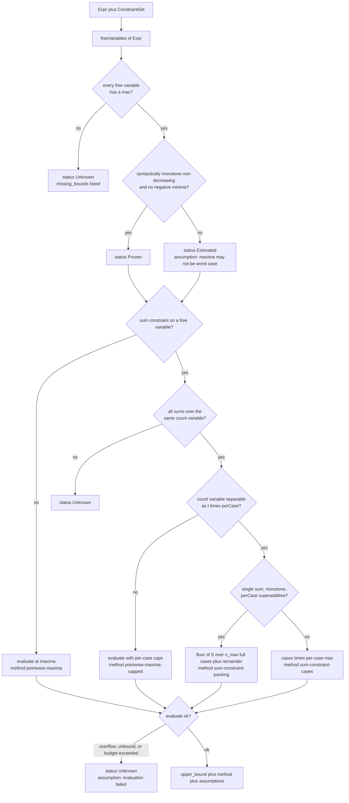
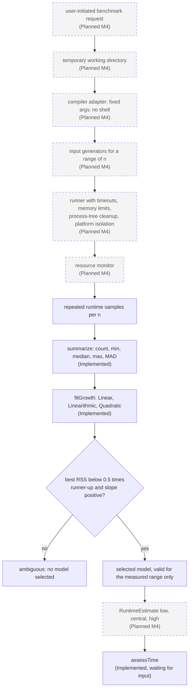
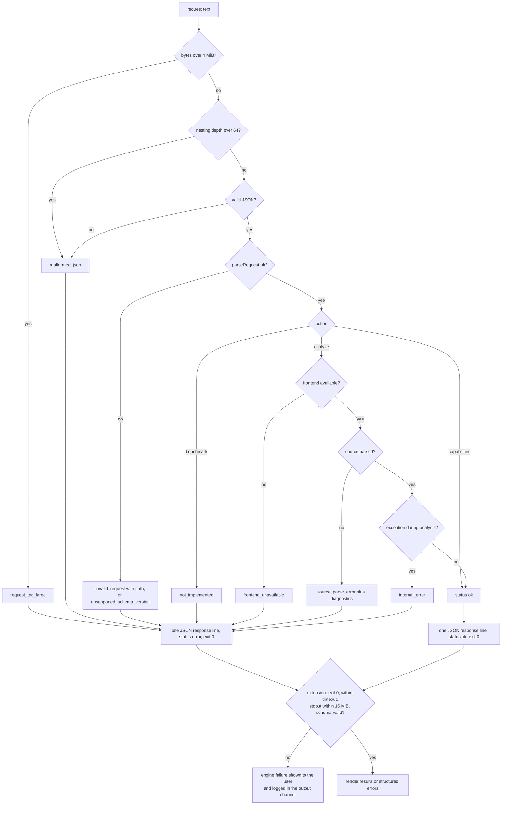

# BigO Lens Architecture

This is the canonical architecture document for BigO Lens 0.1.0 (protocol 1.0). It describes how the system is put together today and where planned work will attach. Every component is labelled with one of three statuses:

- **Implemented**: exists in the repository and is covered by tests.
- **Partial**: exists, but handles only a documented subset of the problem.
- **Planned (Mx)**: not implemented. The milestone (M1 to M6) is the one in [docs/development/ROADMAP.md](docs/development/ROADMAP.md).

Current milestone status: **M1 (Foundation) is in progress**. Early, partial implementations of M2 (static analysis) and M3 (constraint workload) already exist. Dynamic benchmarking (M4) and the rich extension UI (M5) are not implemented.

Related documents:

- [docs/architecture/SYSTEM_DESIGN.md](docs/architecture/SYSTEM_DESIGN.md): classes, ownership, module contracts
- [docs/architecture/COMPONENT_DESIGN.md](docs/architecture/COMPONENT_DESIGN.md): per-component API, status and tests
- [docs/architecture/DATA_FLOW.md](docs/architecture/DATA_FLOW.md): an analyze request traced end to end
- [docs/architecture/DECISIONS/](docs/architecture/DECISIONS/README.md): Architecture Decision Records
- [docs/specifications/JSON_PROTOCOL.md](docs/specifications/JSON_PROTOCOL.md): the wire protocol
- [DESIGN.md](DESIGN.md), [RULES.md](RULES.md), [SECURITY.md](SECURITY.md)

---

## 1. High-level architecture

BigO Lens has three deliverables that communicate only through narrow, explicit interfaces:

| Deliverable | Language | Location | Status |
|---|---|---|---|
| VS Code extension | TypeScript (Node 22 tooling, VS Code ^1.85) | `extension/` | Implemented (scaffold) |
| Analysis engine `bigolens-engine` | C++20 | `engine/` | Partial |
| Benchmark library `bigolens_benchmark` | C++20 | `benchmark/` | Partial (statistics and growth fitting only) |

They are joined by a **versioned JSON protocol** (`shared/schemas/request.schema.json`, `shared/schemas/response.schema.json`, JSON Schema draft 2020-12). The extension starts one engine process per request, writes one JSON request to its stdin and reads one JSON response line from its stdout.

### Diagram 1: system architecture



Dashed boxes are planned. Every other box exists in the repository.

---

## 2. Component responsibilities

| Component | Responsibility | Status |
|---|---|---|
| `engine/src/main.cpp` | Parses CLI flags (`--request FILE`, `--version`, `--help`), reads at most 4 MiB + 1 byte, builds the analyzer, writes exactly one response line. | Implemented |
| `api` (`protocol.hpp`, `request_handler.hpp`) | Validates the request strictly: schema version, field types, unknown fields, ranges, identifier syntax. Dispatches the action, assembles the response and turns every failure into a structured error. | Implemented |
| `models` | Shared vocabulary: `Finding`, `FindingCategory`, `BoundStatus`, `Confidence`, `FeasibilityStatus`, `Severity`, `SourceLocation`, `Diagnostic`. | Implemented |
| `complexity` | Immutable symbolic expression trees, numeric evaluation with overflow and budget detection, and O() derivation. | Implemented |
| `constraints` | The constraint model (`ConstraintSet`), its validation, and worst-case workload evaluation, including sum-constraint packing. | Partial: product and linear constraints are parsed but not used to tighten bounds |
| `estimation` | Static memory lower bounds (`estimateMemory`) and the STL operation cost table (`stlCostTable`, `lookupStlCost`). | Partial: the STL table is data only and is not yet applied to findings |
| `feasibility` | Turns runtime and memory estimates into `LikelySafe`, `Borderline`, `HighRisk` or `Unknown` under a `FeasibilityPolicy`. | Implemented. Time is always `Unknown` today because no runtime estimate exists |
| `analyzers` | The `SourceAnalyzer` interface that separates the core from any C++ frontend. | Implemented |
| `parser` (`clang_frontend.cpp`) | Clang LibTooling frontend: parses with `-fsyntax-only`, then runs loop, recursion and storage analysis. | Partial (see [LIMITATIONS](docs/specifications/LIMITATIONS.md)) |
| `benchmark` | Robust statistics (`summarize`) and least-squares growth-model fitting (`fitGrowth`). It never compiles or runs code. | Partial. Runner, compiler adapter, input generators and resource monitor are Planned (M4) |
| `extension` | Finds the engine, manages per-file constraint sidecars, runs the engine, validates responses and shows results. | Implemented (scaffold). Webview, charts, benchmark controls and problem-statement extraction are Planned (M5 or later) |
| `shared/schemas`, `shared/examples` | The protocol contract and example requests. | Implemented |

---

## 3. Dependency direction and module boundaries

Dependencies flow in one direction only:

```
extension  ->  JSON protocol (shared/schemas)  ->  bigolens-engine
                                                   main.cpp -> api -> {complexity, constraints, estimation, feasibility, models, analyzers}
                                                   parser (Clang) -> analyzers interface (+ models, complexity, estimation types)
bigolens_benchmark: depends on nothing in the engine; the engine does not depend on it yet
```

These rules are enforced by the build:

1. **The extension never links to engine code.** Its only knowledge of the engine is the JSON Schemas. They are copied from `shared/schemas/` into `extension/schemas/` at build time, and every response is validated against them with ajv.
2. **`bigolens_core` has no Clang dependency.** It links only `nlohmann_json`. That is why the core builds and tests on Windows (MSVC) and macOS without LLVM.
3. **Only `engine/src/parser/clang_frontend.cpp` includes Clang headers.** Its public header `parser/clang_frontend.hpp` exposes only `makeClangSourceAnalyzer(ClangFrontendOptions)`, which returns `std::unique_ptr<analyzers::SourceAnalyzer>`. No Clang type crosses the boundary.
4. **The frontend is optional.** With `BIGOLENS_ENABLE_CLANG=OFF` the `BIGOLENS_HAS_CLANG` macro is not defined, `main.cpp` passes a null analyzer to `RequestHandler`, and `analyze` returns `frontend_unavailable`.
5. **`bigolens_benchmark` is independent.** It has its own namespace (`bigolens::benchmark`), its own headers under `benchmark/include/` and its own tests. See [ADR 0009](docs/architecture/DECISIONS/0009-independent-benchmark-subsystem.md).
6. **Inside the core, `api` is the only module that knows JSON.** `complexity`, `constraints`, `estimation`, `feasibility` and `models` are plain C++ value types and functions with no I/O.

---

## 4. Data flow

The extension owns user state: the active document, settings, and the constraints sidecar `<source file>.bigolens.json`. The engine is stateless. Each process handles one request and then exits.

```
active .cpp buffer + sidecar constraints + settings
   -> request JSON (schema_version "1.0", request_id, action, source, constraints, options)
   -> engine: parse/validate -> analyze -> workload -> memory -> feasibility -> response JSON
   -> extension: schema-validate -> tree view, Problems diagnostics, output channel
```

[docs/architecture/DATA_FLOW.md](docs/architecture/DATA_FLOW.md) walks through this with a concrete fixture.

---

## 5. Native-engine communication

- **Transport:** `child_process.spawn` with `shell: false` and **no arguments**. The request is written to stdin and stdin is closed. The engine writes one JSON line to stdout. Stderr is used only for human-readable fatal or internal-error notes.
- **Lifetime:** one process per request. On timeout (`bigoLens.analysisTimeoutMs`, default 30000) the client kills the process.
- **Limits:** the engine accepts requests up to 4 MiB, source content up to 2 MiB and JSON nesting up to depth 64. The nesting check runs before parsing. The client caps stdout at 16 MiB.
- **Versioning:** `schema_version` is `"MAJOR.MINOR"`. The engine accepts the same major version with a minor version less than or equal to its own. Anything else returns `unsupported_schema_version`. Details are in [ADR 0004](docs/architecture/DECISIONS/0004-json-ipc.md) and [JSON_PROTOCOL](docs/specifications/JSON_PROTOCOL.md).
- **Exit codes:** 0 whenever a response was written, including error responses. 2 for usage errors. 1 otherwise.

### Diagram 5: TypeScript-to-C++ communication



---

## 6. Build flow

- CMake 3.24 or later, C++20. The root `CMakeLists.txt` has three options: `BIGOLENS_ENABLE_CLANG=ON`, `BIGOLENS_BUILD_TESTS=ON` and `BIGOLENS_WARNINGS_AS_ERRORS=OFF`. Presets in `CMakePresets.json` are `dev`, `release`, `no-clang` and `ci`.
- `cmake/Dependencies.cmake` uses `find_package` for nlohmann/json 3.11.3 and GoogleTest 1.15.2. If a package is not found, it falls back to `FetchContent` from pinned release URLs verified by SHA-256.
- `cmake/ClangTooling.cmake` finds Clang through `find_package(Clang CONFIG)`. If it is not auto-detected, pass `-DClang_DIR=<llvm>/lib/cmake/clang`.
- `cmake/CompilerWarnings.cmake` provides `bigolens_set_warnings()`.
- Targets: `bigolens_benchmark`, `bigolens_core` (alias `bigolens::core`), `bigolens_clang_frontend` (alias `bigolens::clang_frontend`, only when Clang is enabled) and the `bigolens-engine` executable. Unit tests live in `engine/tests` and `benchmark/tests`, integration tests in `tests/integration`, and all run under `ctest`.
- The extension is built with `npm ci` and the TypeScript compiler. JSON Schemas are copied from `shared/schemas/` into `extension/schemas/`. Development builds are found at `<repo>/build/<preset>/engine/[Debug|Release/]bigolens-engine[.exe]`.



Platform support: Linux is the primary platform with a full build including the Clang frontend (LLVM/Clang 18 in CI). macOS and Windows build and test the core without Clang in CI. The Clang frontend on macOS (Homebrew LLVM) and on Windows is experimental.

---

## 7. Analysis flow (static, Partial)

1. `RequestHandler::handleText` enforces the size and depth limits and parses JSON without exceptions.
2. `parseRequest` validates the request and produces an `api::Request`. On failure it returns `ProtocolError`s and still recovers the `request_id` when it can.
3. The action is dispatched. For `analyze`, `SourceAnalyzer::analyze(SourceInput)` is called.
4. The Clang frontend parses the in-memory file with `-fsyntax-only` and a fixed argument list. Only the validated `cpp_standard` comes from the request. Warnings are suppressed and at most 50 error diagnostics are collected. **If the AST has errors, no analysis runs.**
5. For each function definition in the main file (template primaries only), each top-level loop nest produces one `loop_nest` finding. Its time expression is a **structural count of innermost-body executions**, not CPU instructions and not runtime. Direct recursion produces `recursion` findings with status `Unsupported`. Global or static storage, local constant-size arrays and sized `std::vector` constructions produce storage items.
6. For each finding's time and space expression, the core computes the rendered expression (`toString`), the O() form (`asymptoticUpperBound`), the free variables and the workload (`evaluateWorkload`).
7. `estimateMemory` computes static storage (a proven lower bound) and an estimated minimum footprint.
8. `assessTime` and `assessMemory` produce feasibility statuses.
9. The summary records `finding_count`, `max_time_workload`, `dominant_finding_id` and `coverage: "partial"`.

### Diagram 2: static analysis pipeline



---

## 8. Constraint evaluation

`constraints::evaluateWorkload(expr, constraints)` computes a worst-case value of a symbolic count under the user's constraints. Constraint variables are matched **by name** to identifiers in the source: constraint `n` binds a loop bound `n`, and `v.size()` binds `v.size()`. The full model is in [CONSTRAINT_MODEL](docs/specifications/CONSTRAINT_MODEL.md).

### Diagram 4: constraint evaluation



Product and linear constraints are validated, but they do not tighten bounds yet. An assumption records this. Using them is planned work in M3.

---

## 9. Benchmark flow (Planned, M4)

Only the statistical back end exists today. `summarize` computes robust sample statistics. `fitGrowth` compares `t = a + b * f(n)` for Linear, Linearithmic and Quadratic models. It selects a model only when the best RSS is below 0.5 times the runner-up's and the slope is positive. Otherwise the result is ambiguous. The `benchmark` action currently returns `not_implemented`. See [BENCHMARK_SPECIFICATION](docs/specifications/BENCHMARK_SPECIFICATION.md).

### Diagram 3: dynamic benchmarking pipeline (Planned M4 except where marked)



A fitted model describes the measured range only. It is never presented as proof of complexity ([ADR 0006](docs/architecture/DECISIONS/0006-hybrid-analysis.md), [ADR 0007](docs/architecture/DECISIONS/0007-uncertainty-aware-runtime-estimates.md)).

---

## 10. Error propagation

The engine reports every failure as data and never as a crash:

- `handleText` rejects oversized input (`request_too_large`) and over-deep or invalid JSON (`malformed_json`) before any recursive parsing.
- `parseRequest` collects every validation problem as a `ProtocolError{code, message, path}` with a JSON-pointer `path` (`invalid_request`, `unsupported_schema_version`). The `request_id` is echoed whenever it can be recovered.
- Dispatch errors are `not_implemented` (benchmark) and `frontend_unavailable`.
- Frontend errors become `source_parse_error`. The compiler diagnostics are returned in `diagnostics[]` with source locations.
- Expression evaluation never throws on numeric problems. `EvalStatus::{UnboundVariable, Overflow, DomainError, BudgetExceeded}` becomes workload status `unknown` with an assumption explaining why.
- Any `std::exception` thrown during dispatch or analysis is caught in `RequestHandler::handle` and becomes `internal_error`, with a note on stderr. `main.cpp` has a last-resort catch that exits with status 1.
- The extension treats a non-zero exit code, a timeout, oversized stdout, unparsable stdout or a response that fails schema validation as an engine failure. It reports the failure in the output channel and an error message. It never shows unvalidated data.

### Diagram 6: error handling



Analysis findings that the engine cannot bound are **not errors**. They are successful results with `bound_status` `unknown` or `unsupported` and `confidence: none` ([ADR 0008](docs/architecture/DECISIONS/0008-conservative-unknown-unsupported-results.md)).

---

## 11. Security boundaries

The full threat model is in [docs/engineering/THREAT_MODEL.md](docs/engineering/THREAT_MODEL.md) and [SECURITY.md](SECURITY.md).

| Boundary | Today | Notes |
|---|---|---|
| User source to engine | The source is untrusted input. Clang only parses it (`-fsyntax-only`) and **never executes it**. | Headers named in `#include` are read from the user's filesystem, as a compiler would read them. |
| Request to engine | Size, depth and range limits. Unknown fields are rejected. The request controls only `cpp_standard` among the compiler arguments, from a fixed enum. | The source path is only a display path. Content is parsed from memory. |
| Extension to process | `spawn` with `shell: false` and no arguments, a timeout kill and a capped stdout. | The engine path comes from a setting, an environment variable, the bundled binary or a dev build, in that order. |
| Engine response to UI | Every response is validated against the response schema before use. | The webview (Planned M5) must use a strict CSP and nonce scripts. |
| Benchmark execution | **Not implemented.** | Planned M4: user-initiated, temporary directory, timeouts, memory limits, process-tree cleanup, no shell, fixed compiler argv, platform isolation. A timeout alone is not a sandbox. Until isolation exists, the documentation must say that benchmarking is not sandboxed. |

---

## 12. Extension points

| Extension point | Mechanism | Intended use |
|---|---|---|
| New C++ frontend or analyzer | Implement `analyzers::SourceAnalyzer` (`analyze`, `frontendVersion`) and inject it into `RequestHandler`. | Test doubles, alternative frontends. The core needs no changes. |
| New loop or recursion patterns | Extend `LoopAnalyzer` and `AnalysisVisitor` in `clang_frontend.cpp`. Add a fixture under `tests/fixtures/cpp/` and a case in `tests/integration/frontend_pipeline_test.cpp`. | M2 coverage growth. |
| Recurrence solving | A planned interface that consumes the `Recursion` finding. | Planned (M2/M3 follow-up). Today recursion is `Unsupported`. |
| New expression kinds | Add an `ExprKind`, a factory, a `render` case, evaluator support, asymptotic rules and monotonicity and superadditivity rules. | Only add one when a frontend needs it. |
| Tighter workload methods | Add a method to `evaluateWorkload` that returns a new `method` string. | Using product and linear constraints (M3). |
| STL cost application | Use `lookupStlCost` from the frontend when library calls are found in a loop nest. | Planned. Today the costs appear in limitations only. |
| Runtime estimates | Produce `feasibility::RuntimeEstimate` from the benchmark subsystem. | Planned (M4). |
| Protocol evolution | Add optional fields in a new minor version. Breaking changes need a new major version. | See [ADR 0004](docs/architecture/DECISIONS/0004-json-ipc.md). |
| Extension UI | Add a provider in `extension/src/providers/` that consumes the validated response. | Webview report (Planned M5). |
