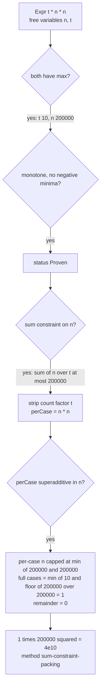
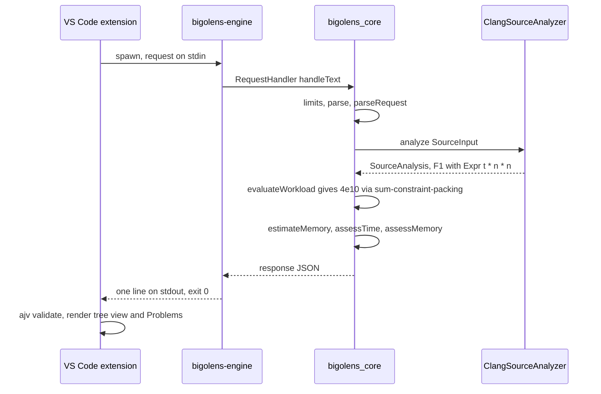

# Data Flow

This document follows data through BigO Lens for three flows:

1. An **analyze** request, end to end, using a real fixture.
2. The **capabilities** request.
3. The **error** flows.

Component names and contracts are defined in [SYSTEM_DESIGN.md](SYSTEM_DESIGN.md). The wire format is specified in [JSON_PROTOCOL](../specifications/JSON_PROTOCOL.md).

---

## 1. Analyze request, end to end

### 1.1 Input program

The input is the fixture `tests/fixtures/cpp/09_sum_constrained_test_cases.cpp`, a typical competitive-programming shape: `t` test cases, each with its own `n`.

```cpp
int main() {
  int t = 0;
  std::cin >> t;
  while (t--) {                      // line 9: test-case loop, t iterations
    int n = 0;
    std::cin >> n;
    long long acc = 0;
    for (int i = 0; i < n; ++i) {    // n iterations
      for (int j = 0; j < n; ++j) {  // n iterations, independent of i (rectangular)
        acc += i * j;
      }
    }
    std::cout << acc << '\n';
  }
}
```

The constraints are those of a typical problem statement: `1 <= t <= 10`, `1 <= n <= 200000`, and **the sum of n over all test cases is at most 200000**.

### 1.2 Step 1: the extension collects inputs (Implemented scaffold)

The user runs **BigO Lens: Analyze Active C++ File** (`bigoLens.analyzeActiveFile`).

1. **Engine location.** The locator checks, in order: `bigoLens.enginePath`, then `BIGOLENS_ENGINE_PATH`, then `<extension>/bin/bigolens-engine[.exe]`, then `<repo>/build/<dev|release|ci|no-clang>/engine/[Debug|Release/]bigolens-engine[.exe]`.
2. **Constraints.** The extension reads the sidecar `09_sum_constrained_test_cases.cpp.bigolens.json` and validates it with ajv. If the sidecar is missing, **BigO Lens: Edit Constraints for Active File** creates it from a template. The sidecar holds exactly the request's `constraints` object:

   ```json
   {
     "variables": { "t": { "min": 1, "max": 10 }, "n": { "min": 1, "max": 200000 } },
     "sum_constraints": [ { "variable": "n", "count_variable": "t", "max_total": 200000 } ],
     "time_limit_ms": 2000,
     "memory_limit_mb": 256
   }
   ```

3. **Request.** The request builder combines the buffer text, the path, the constraints and `bigoLens.cppStandard`. The resulting request is the same one checked in as `shared/examples/analyze.request.json`:

   ```json
   {
     "schema_version": "1.0",
     "request_id": "example-analyze-sum-constraint",
     "action": "analyze",
     "source": { "path": "09_sum_constrained_test_cases.cpp", "language": "cpp", "content": "<file text>" },
     "constraints": { "...": "as above" },
     "options": { "cpp_standard": "c++20" }
   }
   ```

   Constraint variables are matched **by name** to identifiers in the source. Constraint `n` binds the loop bound `n`, and `t` binds the `while (t--)` counter.

### 1.3 Step 2: process launch and transport

The engine client calls `child_process.spawn(enginePath, [], { shell: false })`, writes the request to stdin, and closes stdin. It starts the `bigoLens.analysisTimeoutMs` timer (default 30000 ms) and accumulates stdout up to 16 MiB.

### 1.4 Step 3: engine input handling (Implemented)

| Stage | Component | Effect for this request |
|---|---|---|
| Bounded read | `main.cpp` `readBounded` | Reads at most 4 MiB + 1 byte from stdin |
| Size and depth guard | `RequestHandler::handleText` | Under 4 MiB, nesting depth at most 64: passes |
| JSON parse | nlohmann/json, `allow_exceptions=false` | Valid JSON |
| Validation | `api::parseRequest` | Version `1.0` is accepted (same major, minor not above the engine's). No unknown fields. `request_id` matches `[A-Za-z0-9_.:-]{1,128}`. Constraint integers are in range. `constraints::validate` finds no problems. `memory_limit_mb` 256 becomes `memoryLimitBytes` 268435456. |
| Dispatch | `RequestHandler::handle` | `Action::Analyze` with a non-null analyzer |

### 1.5 Step 4: static analysis in the Clang frontend (Partial)

`ClangSourceAnalyzer::analyze(SourceInput{displayPath, content, "c++20"})`:

1. Parses the in-memory file with `-fsyntax-only` and `-std=c++20`, using the fixed argument list. Warnings are suppressed. `<iostream>` is read from the system include paths. There are no errors, so `parsed = true` and analysis proceeds.
2. `AnalysisVisitor` visits `main`. The top-level loop nest is the `while (t--)` at line 9, and it becomes finding **F1** (category `loop_nest`).
3. `LoopAnalyzer` derives the structure:
   - `while (t--)` is the countdown form, so it has **t** iterations, and the pattern is `test-case-loop`.
   - The outer `for (int i = 0; i < n; ++i)` has **n** trips.
   - The inner `for (int j = 0; j < n; ++j)` has **n** trips. Its bound does not depend on `i`, so it is a rectangular product, not a summation.
   - The innermost body is straight-line and counts 1.
4. The time expression is the product t × n × n. The `multiply` factory flattens nested products but does not merge equal factors into a power, so `toString` renders it as `t * n * n`. It is a **structural count of innermost-body executions**, not an instruction count or a runtime.
5. The status: neither the loop indices nor the bound variable `n` is written inside the `for` bodies, so the nest bound is `Proven` under the stated assumptions. The `std::cin >> n` and `std::cout << acc` expressions are overloaded-operator calls, which the analyzer does not list as library calls, so the finding has no limitations and its confidence is `high`. (Their per-iteration cost is still not part of the structural count; named library calls such as `std::sort` inside a nest would be listed as limitations and lower the confidence to `medium`.)
6. Storage: only scalars (`t`, `n`, `acc`), so there are no storage items.

### 1.6 Step 5: quantity, workload and asymptotic form (Implemented, Partial)

`RequestHandler` builds the `time` quantity of F1:

| Field | Source | Value |
|---|---|---|
| `expression` | `complexity::toString` | t × n × n (rendered `t * n * n`) |
| `asymptotic` | `asymptoticUpperBound` plus `toString` | One monomial with n to the power 2 and t to the power 1. Variables are rendered in name order, giving `O(n^2 t)`. |
| `variables` | `freeVariables` | `["n", "t"]` |
| `workload` | `evaluateWorkload` | see below |

`evaluateWorkload` makes these decisions:



Why this is tight and sound: because n² is superadditive (a² + b² ≤ (a + b)²), concentrating the whole budget Σn ≤ 200000 into as few maximum-size cases as possible maximises the total. One case with n = 200000 costs 4 × 10^10 executions. The naive bound t_max × n_max² = 10 × 4 × 10^10 = 4 × 10^11 overestimates by a factor of 10. The integration test `SumConstrainedTestCasesUseConstraintRelationship` asserts `method == "sum-constraint-packing"`, `upper_bound == 4e10` and `summary.max_time_workload == 4e10`. The unit test `SumConstraintPreventsTTimesNSquared` checks the same logic in isolation.

The resulting workload object:

```json
{
  "status": "proven",
  "upper_bound": 40000000000.0,
  "method": "sum-constraint-packing",
  "assumptions": ["worst case packs 1 test case(s) of maximum size (superadditive per-case cost)"],
  "missing_bounds": []
}
```

### 1.7 Step 6: memory and feasibility (Implemented, conservative)

- `estimateMemory([], constraints)`: static storage is 0 bytes, with no dynamic items. So `estimated_minimum_bytes` is 0 with status `proven`, and the standing assumption applies: process baseline, stack, library internals and unmodelled heap allocations are not included, and the figures are lower bounds, not peaks.
- `assessTime(std::nullopt, 2000)` gives **`unknown`**, with the reason "no runtime estimate available; structural workload alone does not determine runtime". A workload of 4e10 is a strong warning sign, but the engine does not convert counts into milliseconds without measurement ([ADR 0007](DECISIONS/0007-uncertainty-aware-runtime-estimates.md)).
- `assessMemory(memory, std::nullopt, 268435456)` gives **`unknown`**: nothing exceeds the limit, and with only lower bounds known it cannot claim `likely_safe`.

### 1.8 Step 7: the response

The response is one line on stdout and the process exits with code 0. Abridged, with values from the steps above:

```json
{
  "schema_version": "1.0",
  "request_id": "example-analyze-sum-constraint",
  "status": "ok",
  "engine": { "name": "bigolens-engine", "version": "0.1.0", "protocol_version": "1.0", "frontend": "<clang version string>" },
  "results": {
    "findings": [{
      "id": "F1", "category": "loop_nest", "pattern": "test-case-loop", "function": "main",
      "location": { "file": "09_sum_constrained_test_cases.cpp", "line": 9, "column": 3, "...": "..." },
      "time": { "expression": "t * n * n", "asymptotic": "O(n^2 t)", "variables": ["n", "t"],
                "workload": { "status": "proven", "upper_bound": 40000000000.0, "method": "sum-constraint-packing", "...": "..." } },
      "space": null,
      "bound_status": "proven", "confidence": "high",
      "assumptions": ["loop bound assumed to be at least the start value", "..."], "limitations": ["per-iteration cost of library calls is not included: ..."],
      "provenance": "clang-loop-analyzer"
    }],
    "memory": { "static_storage_bytes": 0, "estimated_minimum_bytes": 0, "estimated_minimum_status": "proven", "items": [], "...": "..." },
    "feasibility": { "time": { "status": "unknown", "reason": "no runtime estimate available; ..." },
                     "memory": { "status": "unknown", "reason": "only lower bounds are known; ..." } },
    "summary": { "finding_count": 1, "max_time_workload": 40000000000.0, "dominant_finding_id": "F1", "coverage": "partial" }
  },
  "diagnostics": [],
  "errors": []
}
```

The values asserted by tests are the pattern, method, upper bound and `max_time_workload`. The exact `expression` and `asymptotic` strings, the column and the wording of limitations are what the documented rendering rules produce. To confirm the exact output for a given build, run `bigolens-engine --request shared/examples/analyze.request.json`.

### 1.9 Step 8: presentation (Implemented scaffold)

1. The engine client confirms exit code 0, the stdout size cap and the timeout, then validates the JSON against `response.schema.json` with ajv.
2. The **Analysis Results** tree view shows F1 with its pattern, O() form, workload `4e10` (`sum-constraint-packing`), bound status `proven`, confidence `high`, and the memory and feasibility summary. Clicking it opens line 9.
3. An Information-level diagnostic for F1 appears in the Problems panel.
4. The raw exchange is logged to the **BigO Lens** output channel.



---

## 2. Capabilities flow

The command **BigO Lens: Show Engine Capabilities** (`bigoLens.showCapabilities`) sends:

```json
{ "schema_version": "1.0", "request_id": "example-capabilities", "action": "capabilities" }
```

The engine validates it and returns `results` **without using the frontend**. The test `CapabilitiesSucceedWithoutFrontend` shows this works on a build without Clang. The results contain:

- `actions`: `["capabilities", "analyze", "benchmark"]`. `benchmark` is listed because the protocol defines it, but its feature status is `not_implemented`.
- `features`: `loop_analysis: partial`, `while_countdown_loops: partial`, `range_for_loops: partial`, `recursion_analysis: unsupported`, `recurrence_extraction: partial`, `stl_cost_model: data_only`, `interprocedural_analysis: unsupported`, `constraint_workload: partial`, `static_memory_estimate: partial`, `time_feasibility: requires_runtime_estimate`, `benchmark: not_implemented`.
- `stl_cost_model`: the table from `estimation::stlCostTable()`, with each entry's `container`, `operation`, `average`, `worst`, `amortized` and `note`.

`engine.frontend` tells the client whether `analyze` is available: it is a Clang version string, or `null` when the engine was built with `BIGOLENS_ENABLE_CLANG=OFF`. The extension shows the results in the output channel.

---

## 3. Error flows

Every engine-side failure produces **one well-formed response** with `status: "error"`, `results: null`, a non-empty `errors[]` and exit code 0. The `request_id` is echoed whenever it could be recovered.

| Trigger | Detected in | `errors[].code` | Extra data |
|---|---|---|---|
| Input over 4 MiB | `handleText` | `request_too_large` | `request_id` is null |
| Nesting deeper than 64, or not JSON (for example `shared/examples/malformed.request.txt`) | `handleText` | `malformed_json` | `request_id` is null |
| Unknown field, wrong type, out-of-range value, bad `request_id`, source over 2 MiB, language other than `cpp` | `parseRequest` | `invalid_request` | `path` holds a JSON pointer |
| Major version differs, or minor version is above the engine's | `parseRequest` | `unsupported_schema_version` | `path: "/schema_version"` |
| `action: "benchmark"` | `handle` | `not_implemented` | none |
| `analyze` on an engine built without Clang | `handle` | `frontend_unavailable` | none |
| C++ source has errors | Frontend, then `handle` | `source_parse_error` | `diagnostics[]` holds up to 50 compiler errors with locations |
| Unexpected `std::exception` | `handle` catch block | `internal_error` | A note on stderr |

Example: `shared/examples/invalid.request.json` contains `"unexpected": true` and has no `source` for an `analyze` action. `parseRequest` reports **every** problem rather than only the first:

```json
"errors": [
  { "code": "invalid_request", "message": "unknown field 'unexpected'", "path": "/unexpected" },
  { "code": "invalid_request", "message": "missing required field 'source'", "path": "/source" }
]
```

with `"request_id": "example-invalid"` echoed.

**Results that are not errors.** A loop the engine cannot bound is not an error. Examples are fixture 06 (binary search), fixture 10 (data-dependent termination) and `neg_modified_index.cpp`. Each produces a successful response with `bound_status: "unknown"` or `"unsupported"`, `confidence: "none"` and a limitation explaining why. A missing constraint gives a workload `status: "unknown"` with `missing_bounds` listing the variables. Evaluation overflow or budget exhaustion gives `status: "unknown"` with an `"evaluation failed: ..."` assumption.

**Extension-side failures.** These are not reported in the engine's JSON:

| Failure | Handling |
|---|---|
| Engine not found | An error message listing every location the locator checked |
| Invalid sidecar constraints | ajv errors are reported. No request is sent. |
| Timeout | The process is killed and the timeout is reported |
| stdout over 16 MiB | The process is killed and the output is rejected |
| Non-zero exit code, or stdout is not JSON | Reported as an engine failure. Stderr is logged to the output channel. |
| Response fails schema validation | Rejected and never rendered |

The diagrammatic version of these flows is in [ARCHITECTURE.md, section 10](../../ARCHITECTURE.md#10-error-propagation).
