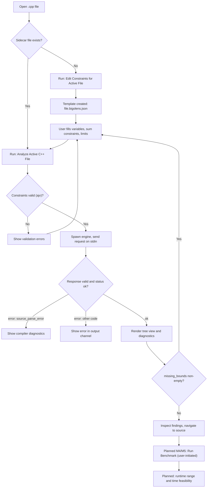

# UI/UX Design — VS Code Extension

This document specifies the user interface of the BigO Lens VS Code extension. Every section separates
**Implemented scaffold (M1)** — what the extension does today — from **Planned (M5)** or later milestones.

Related: [DESIGN.md](../../DESIGN.md) · [ANALYSIS_MODEL.md](ANALYSIS_MODEL.md) ·
[JSON_PROTOCOL.md](../specifications/JSON_PROTOCOL.md) · [CONFIGURATION.md](../user/CONFIGURATION.md) ·
[GETTING_STARTED.md](../user/GETTING_STARTED.md)

Platform baseline: VS Code `^1.85`, Node 20. The extension is TypeScript and talks to the native engine only through
the [JSON protocol](../specifications/JSON_PROTOCOL.md).

---

## 1. Design rules for the UI

1. **Every number has a label and a kind.** A workload is shown as a *structural count*, never as "operations per
   second" or "ms". Runtime appears only when a runtime estimate exists (M4).
2. **Bound status and confidence are shown separately**, side by side, never merged into one badge.
3. **Unknown and unsupported are visible results**, not omissions. A finding with no time expression still
   appears, with its reason.
4. **Assumptions and limitations are one click away** from every finding.
5. **No colour-only meaning** (see [§14](#14-accessibility-and-theming)).
6. **The UI never invents constraints.** Suggested constraints (future) are drafts until the user confirms them.

---

## 2. Command palette

### Implemented scaffold (M1)

| Command ID | Title | Behaviour |
| --- | --- | --- |
| `bigoLens.analyzeActiveFile` | BigO Lens: Analyze Active C++ File | Loads and validates the sidecar constraints file if present, sends an `analyze` request for the active C++ file, renders results |
| `bigoLens.editConstraints` | BigO Lens: Edit Constraints for Active File | Opens `<file>.bigolens.json`; creates it from a template first if it does not exist |
| `bigoLens.showCapabilities` | BigO Lens: Show Engine Capabilities | Sends a `capabilities` request and prints actions, feature statuses and the STL cost table to the *BigO Lens* output channel |

### Planned

| Command (proposed) | Milestone | Purpose |
| --- | --- | --- |
| BigO Lens: Open Report | M5 | Opens the webview report for the last analysis |
| BigO Lens: Configure Constraints (Form) | M5 | Opens the constraint form instead of raw JSON |
| BigO Lens: Suggest Constraints from Problem Statement | After M5 | Opens the statement input panel |
| BigO Lens: Run Benchmark | M4 (engine) + M5 (UI) | User-initiated benchmark with explicit confirmation |
| BigO Lens: Cancel Benchmark | M4 + M5 | Kills the benchmark process tree |

Command IDs for planned commands are not fixed until implemented.

---

## 3. Sidebar

### Implemented scaffold (M1)

Activity-bar container **BigO Lens** with one tree view **Analysis Results**.

```
BIGO LENS
└─ ANALYSIS RESULTS
   ├─ F1  test-case-loop  O(n^2 t)                 main
   │     workload ≤ 4e10 (sum-constraint-packing)
   │     bound: proven · confidence: high
   ├─ F2  data-dependent-loop  —                    solve
   │     workload: unknown
   │     bound: unknown · confidence: none
   ├─ F3  multiple-direct-recursion  —              fib
   │     bound: unsupported · confidence: none
   ├─ Memory
   │     static storage: 4000 B (proven lower bound)
   │     estimated minimum: 1.6 MB (estimated)
   └─ Feasibility
         time: unknown — no runtime estimate available
         memory: unknown — only lower bounds are known
```

The O() strings and numbers above illustrate layout only; actual text comes verbatim from the engine response.

- Each finding node shows `id`, `pattern`, `time.asymptotic` (or `—` when null), workload `upper_bound` with
  `method`, `bound_status` and `confidence`.
- Clicking a finding navigates to `location` (see [§12](#12-source-navigation)).
- Memory and feasibility nodes summarise `results.memory` and `results.feasibility`.

### Planned (M5)

- Group findings by function; sort by workload (dominant first, using `summary.dominant_finding_id`).
- Inline expand for assumptions and limitations as child nodes.
- Toolbar actions: *Analyze*, *Edit Constraints*, *Open Report*.
- Status bar item: `BigO: max ≤ 4e10 · time ? · mem ?` that opens the report.

---

## 4. Manual constraint configuration

### Implemented scaffold (M1): sidecar file

Constraints are stored per source file in `<source file>.bigolens.json`, next to the source. The file contains the
`constraints` object of the [request schema](../../shared/schemas/request.schema.json) (see
[CONSTRAINT_MODEL.md](../specifications/CONSTRAINT_MODEL.md)). Example for `solution.cpp`:

```json
{
  "variables": {
    "t": { "min": 1, "max": 10 },
    "n": { "min": 1, "max": 200000 }
  },
  "sum_constraints": [{ "variable": "n", "count_variable": "t", "max_total": 200000 }],
  "time_limit_ms": 2000,
  "memory_limit_mb": 256
}
```

Behaviour:

- **BigO Lens: Edit Constraints for Active File** creates the file from a template if missing and opens it.
- Before every analysis the file is parsed and validated with ajv against the schema shipped with the extension.
  Invalid files block the analysis and the errors are reported; the analysis is never run with a partially valid
  file.
- Engine-side validation still applies (e.g. sum-constraint variables must have declared upper bounds); its errors
  are surfaced with their JSON-pointer `path`.
- Variable names must match **identifiers in the source** (`n`, `m`) or `name.size()` for containers. A name that
  does not appear in any expression simply has no effect; a variable that appears but has no bound shows up in
  `missing_bounds`.

### Planned (M5): constraint form

```
┌ BigO Lens — Constraints: solution.cpp ───────────────────────────────┐
│ Variables                                                     [+ Add] │
│  Name        Min        Max          Detected in source               │
│  t           1          10           while (t--)  line 9             │
│  n           1          200000       for i < n    line 13            │
│  m           —          —            ⚠ used in loop bound, no bound   │
│                                                                       │
│ Relationships                                                 [+ Add] │
│  Sum      Σ n over t cases ≤ 200000                     [used]       │
│  Product  n · m ≤ 1000000                 [validated, not used yet]  │
│                                                                       │
│ Limits     Time [ 2000 ] ms     Memory [ 256 ] MB                     │
│                                                                       │
│ [Validate]   [Save to solution.cpp.bigolens.json]   [Analyze]        │
└───────────────────────────────────────────────────────────────────────┘
```

- The form reads and writes the same sidecar file; the file remains the source of truth.
- "Detected in source" lists free variables of returned expressions (`time.variables`, `space.variables`) and
  `missing_bounds` from the last analysis. It never guesses bound values.
- Relationship rows state whether the engine *uses* or only *validates* the relationship (see
  [CONSTRAINT_MODEL.md §11](../specifications/CONSTRAINT_MODEL.md#11-what-is-used-today)).
- Inputs accept `2e5`, `2*10^5` and `200000`; the form normalises to integers before saving and shows the
  normalised value.

---

## 5. Problem-statement input (future, after M5)

Not implemented. Design constraints:

```
┌ Suggest constraints from statement ──────────────────────────────────┐
│ Paste the constraints section of the problem statement:              │
│ ┌──────────────────────────────────────────────────────────────────┐ │
│ │ 1 ≤ t ≤ 10^4. 1 ≤ n ≤ 2·10^5. The sum of n over all test cases   │ │
│ │ does not exceed 2·10^5.                                          │ │
│ └──────────────────────────────────────────────────────────────────┘ │
│ Extractor: (•) Offline rules   ( ) Optional LLM (disabled)           │
│                                                                       │
│ Candidates (nothing is applied until you confirm)                     │
│  [x] t ∈ [1, 10000]            from "1 ≤ t ≤ 10^4"                    │
│  [x] n ∈ [1, 200000]           from "1 ≤ n ≤ 2·10^5"                  │
│  [x] Σ n over t ≤ 200000       from "sum of n over all test cases…"   │
│  [ ] ?  "a_i ≤ 10^9"  → no matching source identifier                 │
│                                                                       │
│ [Confirm selected → merge into sidecar file]    [Discard]            │
└───────────────────────────────────────────────────────────────────────┘
```

Rules:

- **Offline first:** extraction uses regular expressions and heuristics (inequality chains, `10^k`, `2·10^5`,
  "sum of … over all test cases"). It works without network access.
- **Optional LLM:** an LLM-based extractor may be added later as an opt-in setting, off by default. The product must
  be fully functional without it. Its output is treated exactly like heuristic output: candidates only.
- **User confirmation is mandatory.** Each candidate shows the source text span it came from. Nothing is written to
  the sidecar file until the user confirms. Confirmed values are ordinary constraints with no special trust.
- Candidates that cannot be bound to a source identifier are shown as unbound and are unchecked by default.
- No problem statement is ever fetched from a contest platform.

---

## 6. Analysis results

### Implemented scaffold (M1)

- Tree view as in [§3](#3-sidebar).
- One **Information**-level diagnostic per finding in the Problems panel, ranged to the finding location.
  Diagnostics are deliberately not warnings or errors: a finding
  is information, not a defect.
- Engine compiler diagnostics for `source_parse_error` are shown in the output channel with their locations.
- Output channel **BigO Lens** receives engine and protocol errors and the capabilities report.

### Planned (M5): webview report

```
┌ BigO Lens Report — solution.cpp ─────────────── engine 0.1.0 · clang … ┐
│ Summary   3 findings · coverage: partial · dominant: F1                 │
│           max structural workload ≤ 4.0e10 (not a runtime)              │
│ Feasibility   Time: UNKNOWN (no runtime estimate)                       │
│               Memory: UNKNOWN (only lower bounds known)                 │
├─────────────────────────────────────────────────────────────────────────┤
│ F1  test-case-loop · main · line 9                       [Go to source] │
│     Expression   t * n^2                                                │
│     Asymptotic   O(n^2 t)                                               │
│     Workload     ≤ 4e10  method: sum-constraint-packing                 │
│     Bound        PROVEN        Confidence  HIGH                         │
│     Assumptions  ▸ 3     Limitations ▸ 0     Provenance clang-loop-…    │
├─────────────────────────────────────────────────────────────────────────┤
│ F2  data-dependent-loop · solve · line 22                [Go to source] │
│     Expression   —   (iteration count could not be determined)          │
│     Bound        UNKNOWN       Confidence  NONE                         │
│     Why          data-dependent termination: the iteration count …      │
└─────────────────────────────────────────────────────────────────────────┘
```

The webview must use a strict Content Security Policy with nonce-based scripts, load no remote resources, and treat
all engine strings as text (never as HTML). See [THREAT_MODEL.md](../engineering/THREAT_MODEL.md).

---

## 7. Complexity explanation

### Implemented scaffold (M1)

Tree-node tooltips show `description`, `time.expression`, `assumptions` and `limitations` verbatim.

### Planned (M5)

An explanation panel per finding, generated deterministically from the response (no LLM):

1. *What is counted:* "executions of the innermost loop bodies" (structural count).
2. *Per-loop trip counts* as reported in assumptions (e.g. "geometric index growth: at most log_2(bound) + 1
   iterations").
3. *How the O() was derived:* dominant monomials of the expression.
4. *What is not included:* library call costs, callee costs, early exits (upper bound).
5. *Bound status rationale:* why it is `proven`, `estimated`, `unknown` or `unsupported`.

---

## 8. Runtime estimates (future, M4 engine + M5 UI)

Not implemented; the protocol has no runtime field yet. When added, runtime is displayed as a **central value with
a range** and the measurement basis:

```
Runtime (estimated for target)   central 0.84 s   range 0.61 – 1.30 s
Basis   benchmark on this machine, 6 sizes up to n = 50000, median of 7 runs
Model   quadratic fit (selected; runner-up RSS ratio 0.21) — extrapolated
⚠ Extrapolated beyond measured sizes. Not a guarantee for the judge machine.
```

(Values are a layout illustration only.) Rules: always show the range; mark extrapolation; show "ambiguous" when the
growth fit could not discriminate; never show a runtime derived solely from structural counts.

---

## 9. Memory estimates

### Implemented scaffold (M1)

Memory node shows `static_storage_bytes` (proven lower bound; flagged if `static_storage_saturated`),
`largest_local_array_bytes`, `estimated_minimum_bytes` with `estimated_minimum_status`, and the item list
(`global_static`, `local_array`, `vector_buffer`) with exact or symbolic sizes.

### Planned (M5)

- Always label as **lower bound / estimated minimum**, never as "memory usage" or "peak".
- Show measured peak RSS from benchmarks (M4) in a separate row with its own label.
- Human-readable units (KiB/MiB, binary) with exact byte counts in the tooltip.

---

## 10. Warnings

Severity mapping (planned M5; M1 uses Information for all findings):

| Condition | Presentation |
| --- | --- |
| Feasibility `high_risk` (time or memory) | Warning diagnostic on the dominant finding / storage item, red-independent icon `$(warning)` plus text "HIGH RISK" |
| Feasibility `borderline` | Information diagnostic, text "BORDERLINE" |
| `missing_bounds` non-empty | Hint in tree: "no bound for n — add it in constraints" with action |
| Index modified in body, data-dependent loop | Shown as finding with status, not as a warning |
| Product/linear constraint not used | Assumption text displayed in the workload section |

BigO Lens never reports a correctness error about the user's code.

---

## 11. Unsupported and unknown findings

Both appear in every view with the same prominence as proven findings:

- Pattern (`unsupported-loop`, `data-dependent-loop`, `direct-recursion`, `multiple-direct-recursion`).
- `—` for expression and O().
- The reason from `limitations`, e.g. "loop index 'i' is modified in the body", "do-while loops are not modelled
  yet", "time and stack depth of recursive functions are not estimated yet (milestone M2+)".
- Summary counts them; the summary never implies full coverage (`coverage` is always `partial` in protocol 1.0).

---

## 12. Source navigation

### Implemented scaffold (M1)

- Clicking a finding opens the source document and selects `location.line:column` to
  `end_line:end_column` (when present). Engine lines and columns are Clang's 1-based presumed locations (macro
  uses are mapped to their expansion site; `0` means "unknown"); the extension converts them to VS Code's 0-based
  positions. `end_column` is the start of the last token of the range, not one past its end.
- Problems-panel diagnostics navigate the same way.

### Planned (M5)

- CodeLens above each analysed loop: `O(n^2) · ≤ 4e10 · proven` (opt-in setting).
- Results marked stale (greyed, "stale" label) once the document changes after analysis.

---

## 13. Benchmark controls (future, M4 + M5)

Not implemented; the engine returns `not_implemented` for `benchmark`.

```
┌ Benchmark — solution.cpp ────────────────────────────────────────────┐
│ ⚠ Runs your compiled program on this machine. Not sandboxed on this │
│   platform yet (resource limits only).                               │
│ Compiler  [ g++ ▾ ]  Flags [ -O2 -std=c++20 ]                        │
│ Generator [ random array of size n ▾ ]   Seed [ 12345 ]              │
│ Sizes     progressive: start 1000, ×2, stop at 1 s per run or n_max  │
│ Repeats   [ 7 ]   Warm-up [ 1 ]   Per-run timeout [ 5 ] s            │
│ Memory cap [ 512 ] MB                                                │
│                                       [Run benchmark]   [Cancel]     │
│ Progress  n=16000  run 4/7  ███████░░░░                              │
└──────────────────────────────────────────────────────────────────────┘
```

Requirements: explicit user action per run; visible warning about isolation state; cancel kills the process tree;
results show median, MAD, peak RSS and fit result per [BENCHMARK_SPECIFICATION.md](../specifications/BENCHMARK_SPECIFICATION.md).

---

## 14. Accessibility and theming

- Use VS Code theme colours (`ThemeColor`) and codicons only; no hard-coded colours in the tree, diagnostics or
  webview. The webview uses `--vscode-*` CSS variables and supports light, dark and high-contrast themes.
- Status is always conveyed by text (`PROVEN`, `UNKNOWN`, `HIGH RISK`) in addition to icon or colour.
- All tree items have accessible labels that read the full status ("bound status proven, confidence high").
- Webview: semantic HTML (headings, tables with header cells), keyboard-navigable, visible focus, no information
  only on hover. Respects `prefers-reduced-motion`; no animations required for understanding.
- Numbers use plain notation with an exponent form (`4e10`) and the exact value in tooltips; no locale-dependent
  thousands separators in machine-copied values.

---

## 15. User flow



Nodes labelled *Planned* do not exist yet.
