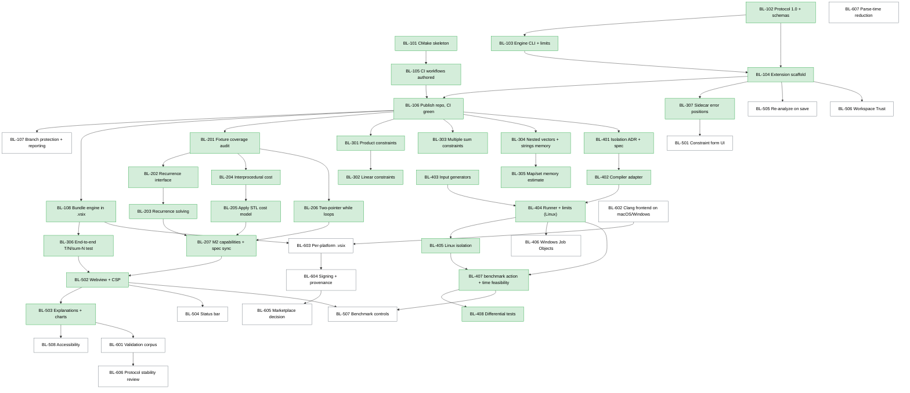

# Implementation Plan

This is the issue backlog for BigO Lens, organized by milestone (see [ROADMAP.md](ROADMAP.md)). Each issue is written to be copied into GitHub as is: the heading becomes the issue title, and the fields become the body.

**Conventions**

- **IDs:** `BL-<milestone><nn>`, for example BL-203 is milestone 2, issue 03. Reference them in branches (`feat/bl-203-...`) and commits (`Refs BL-203`).
- **Priority:** **P0** blocks the milestone or other work. **P1** is required for the milestone. **P2** is important but can slip to the next milestone. **P3** is nice to have.
- **Estimated complexity:** **S**, **M**, **L** or **XL**. These are *relative* estimates of effort and uncertainty, not time commitments or guarantees.
- **Definition of Done:** every issue inherits [DEFINITION_OF_DONE.md](DEFINITION_OF_DONE.md). The DoD field lists only the additions specific to the issue.
- **Status: Done in foundation** marks work completed in the initial foundation commit. These issues are kept here as a record and to show how later work depends on them. Do not reopen them. File follow-ups instead.

## Recommended next issue

> **[BL-301: Use product constraints to tighten workloads](#bl-301-use-product-constraints-to-tighten-workloads).**
>
> M2 (Analysis: loop forms, recursion and storage) is complete! BL-207 synchronized M2 capabilities, specifications, and example responses.
> BL-301 uses `product_constraints` (e.g. `n·m ≤ 10^6`) to tighten workloads for monotone expressions.

## Dependency graph

Green nodes are done in the foundation. Red nodes are on the critical path.

**Critical path to the MVP (M1–M3 plus M5):** BL-106 → BL-108 → BL-201 → BL-202 → BL-203 → BL-207 → BL-502 → BL-503. BL-306 (which depends on BL-108) also gates BL-502.

**Parallelizable work** (independent tracks once BL-106 is done):

- **M3 constraints track:** BL-301 → BL-302, and BL-303. This needs only the core library and no Clang.
- **M3 memory track:** BL-304 → BL-305
- **M2 side tracks:** BL-204 → BL-205, and BL-206, which can run in parallel with BL-202 and BL-203 after BL-201
- **M4 benchmark track:** BL-401 → BL-402 or BL-403 → BL-404 → BL-405, BL-406 → BL-407 → BL-408. This is fully independent of M2, M3 and M5 until BL-507.
- **M5 extension-only items:** BL-307 → BL-501, BL-505 and BL-506, which can start as soon as the scaffold exists
- **M6:** BL-602 and BL-607 can start at any time

---

## M1: Foundation

### BL-101: CMake build skeleton, presets and pinned dependencies

- **Status:** Done in foundation
- **Priority:** P0
- **Estimated complexity:** M (relative)
- **Dependencies:** none

**Description.** Set up the root CMake project (C++20, CMake 3.24 or newer) with options `BIGOLENS_ENABLE_CLANG`, `BIGOLENS_BUILD_TESTS` and `BIGOLENS_WARNINGS_AS_ERRORS`. Add `CMakePresets.json` (`dev`, `release`, `no-clang`, `ci`), the modules `cmake/ClangTooling.cmake`, `cmake/Dependencies.cmake` and `cmake/CompilerWarnings.cmake`, and the targets `bigolens_core`, `bigolens_clang_frontend`, `bigolens_benchmark` and `bigolens-engine`.

**Motivation.** A reproducible build that works without Clang is the precondition for cross-platform CI.

**Scope.** In scope: build, presets, warning policy, dependency pinning (`find_package` first, FetchContent with SHA-256 otherwise), and Clang resource-directory detection. Out of scope: packaging.

**Acceptance criteria.**
- [x] `cmake --preset dev && cmake --build --preset dev && ctest --preset dev` succeeds on Linux with Clang development libraries installed.
- [x] The `no-clang` preset builds and tests without any Clang installation.
- [x] Dependencies are pinned to nlohmann/json 3.11.3 and GoogleTest 1.15.2 with SHA-256.

**Test cases.** The CTest suite under both presets.

**Definition of Done.** DoD, plus: no machine-specific paths in CMake files.

### BL-102: JSON protocol 1.0, schemas and examples

- **Status:** Done in foundation
- **Priority:** P0
- **Estimated complexity:** L (relative)
- **Dependencies:** none

**Description.** Define protocol 1.0 for the `capabilities`, `analyze` and `benchmark` actions: request and response envelopes, the constraints object, options, and the closed set of error codes. Write `shared/schemas/request.schema.json` and `response.schema.json` (draft 2020-12). Generate the examples in `shared/examples/` by running the real engine.

**Motivation.** The protocol is the only contract between the engine and its clients. Versioning it from the start allows the two to evolve independently.

**Scope.** In scope: schemas, the C++ validator (`api::parseRequest`), serialization, examples, and [JSON_PROTOCOL.md](../specifications/JSON_PROTOCOL.md). Out of scope: implementing the `benchmark` action, which returns `not_implemented`.

**Acceptance criteria.**
- [x] Unknown fields are rejected, and every validation error carries a JSON-pointer path.
- [x] Example responses validate against the response schema.
- [x] Schema version negotiation: same major version, minor version less than or equal to the engine's.

**Test cases.** `engine/tests/protocol_test.cpp`, the `engine_cli.*` CTest tests, and `npm run validate:schemas`.

**Definition of Done.** DoD, plus: the example responses were produced by the engine, not written by hand.

### BL-103: Engine CLI, request handler and input limits

- **Status:** Done in foundation
- **Priority:** P0
- **Estimated complexity:** M (relative)
- **Dependencies:** BL-102

**Description.** `bigolens-engine [--request FILE]` reads one request from a file or stdin and writes one response line to stdout. It supports `--version` and `--help`. The exit code is 0 when a response was written, 2 for usage errors, and 1 otherwise. Requests are limited to 4 MiB, source content to 2 MiB and nesting depth to 64 (checked before parsing). `RequestHandler` never throws.

**Motivation.** A minimal, robust process boundary that is safe to feed with untrusted input.

**Scope.** In scope: the CLI, the handler and the limits. Out of scope: a persistent server mode.

**Acceptance criteria.**
- [x] Oversized, deeply nested and malformed requests return structured errors.
- [x] Nothing except the response is written to stdout.

**Test cases.** `Protocol.OversizedRequestIsRejected`, `Protocol.ExcessiveNestingIsRejectedBeforeParsing`, `engine_cli.malformed_json`, `engine_cli.unknown_argument`, `engine_cli.version`.

**Definition of Done.** DoD.

### BL-104: VS Code extension scaffold

- **Status:** Done in foundation
- **Priority:** P0
- **Estimated complexity:** L (relative)
- **Dependencies:** BL-102, BL-103

**Description.** A TypeScript extension (Node 22 tooling, VS Code ^1.85) with the commands `bigoLens.analyzeActiveFile`, `bigoLens.editConstraints` and `bigoLens.showCapabilities`. It locates the engine (setting, then environment variable, then bundled binary, then development build), reads sidecar constraints `<file>.bigolens.json` with ajv validation, and spawns the engine with `shell: false`, a timeout and a 16 MiB stdout cap. It validates responses, and shows results in the "Analysis Results" tree view, Problems-panel diagnostics and the "BigO Lens" output channel.

**Motivation.** It provides the end-to-end user path, and a client that exercises the protocol.

**Scope.** In scope: everything above. Out of scope: the webview, forms and benchmark controls (M5).

**Acceptance criteria.**
- [x] Unit tests run without VS Code.
- [x] The integration test runs against a real engine, or skips with a message.
- [x] The smoke test verifies activation and command registration.

**Test cases.** `npm test`, `npm run test:integration`, `npm run test:vscode`.

**Definition of Done.** DoD.

### BL-105: Author CI, code-quality, security and release workflows

- **Status:** Done in foundation (the workflows are authored; running them on GitHub is BL-106)
- **Priority:** P0
- **Estimated complexity:** M (relative)
- **Dependencies:** BL-101

**Description.** Write `ci.yml` (a native matrix: Ubuntu full with Clang 18, Windows and macOS core, an experimental macOS Clang job; plus an extension job), `code-quality.yml` (clang-format, clang-tidy, ESLint, Prettier, `-Werror` configure), `security.yml` (CodeQL for C/C++ and JS/TS, dependency review, npm audit), `release.yml` (tag `v*.*.*`: version check, build, test, package, GitHub Release) and `dependabot.yml`.

**Motivation.** Automated verification on all platforms, with least-privilege permissions.

**Scope.** In scope: workflow files. Out of scope: actually running them, which is BL-106.

**Acceptance criteria.**
- [x] Every workflow declares minimal `permissions`.
- [x] Only official actions are used.

**Test cases.** Covered by BL-106.

**Definition of Done.** DoD.

### BL-106: Publish the repository and verify CI green on all platforms

- **Status:** Done. Ubuntu (Clang frontend), Windows and macOS (core) and all extension jobs pass. CodeQL, clang-tidy, clang-format and ESLint pass. Fixes needed on the first runs: GCC `-Wnull-dereference` false positives at `-O2`, and the retired `macos-14` runner image. The experimental macOS Clang job still fails (header mismatch, see TROUBLESHOOTING.md).
- **Priority:** P0
- **Estimated complexity:** M (relative). There is uncertainty: the workflows have never run, so platform-specific fixes are likely.
- **Dependencies:** BL-104, BL-105

**Description.** Create `https://github.com/chowdhuryrifat/bigo-lens`, push `main`, and iterate until every required job in `ci.yml`, `code-quality.yml` and `security.yml` passes. Fix whatever the first real runs reveal: package names on the runners, Clang discovery (`Clang_DIR`), the MSVC warning policy, xvfb for the smoke test, and clang-tidy findings.

**Motivation.** No other change can be validated in CI until CI runs. The platform-support claims in the documentation depend on it.

**Scope.** In scope: workflow and build fixes, and documentation corrections where reality differs. Out of scope: new features, or making the experimental macOS Clang job pass (it is allowed to fail).

**Acceptance criteria.**
- [ ] `ci.yml` is green on `main` for Ubuntu (full, with Clang), Windows (core) and macOS (core).
- [ ] The extension job is green: compile, lint, unit tests, schema validation, the VS Code smoke test under xvfb, and the integration test against the engine built in the same job.
- [ ] `code-quality.yml` and `security.yml` are green, or every remaining finding has a linked issue.
- [ ] [TROUBLESHOOTING.md](TROUBLESHOOTING.md) and [CONTRIBUTING.md](../../CONTRIBUTING.md) reflect any fixes that contributors also need.

**Test cases.** A full CI run on `main`, and a pull request from a branch that triggers dependency review.

**Definition of Done.** DoD, plus: links to the green runs in the pull request or issue. The documentation's platform table matches the observed results.

### BL-107: Enable branch protection, private vulnerability reporting and issue templates

- **Status:** Not started
- **Priority:** P1
- **Estimated complexity:** S (relative)
- **Dependencies:** BL-106

**Description.** Configure the GitHub repository: protect `main` (required status checks from BL-106, at least one approving review, no force-pushes, no deletion), enable private vulnerability reporting, enable Dependabot alerts, and confirm that the issue templates (bug report, feature request, documentation) render correctly.

**Motivation.** [SECURITY.md](../../SECURITY.md) and [GIT_WORKFLOW.md](../engineering/GIT_WORKFLOW.md) rely on these settings.

**Scope.** In scope: repository settings and template fixes. Out of scope: CODEOWNERS for multiple maintainers.

**Acceptance criteria.**
- [ ] A direct push to `main` is rejected.
- [ ] "Report a vulnerability" appears on the Security tab.
- [ ] The three issue templates appear under "New issue".

**Test cases.** Attempt a direct push. Open a test issue from each template and close it.

**Definition of Done.** DoD, plus: settings recorded in an ADR or in a maintainer note.

### BL-108: Bundle the engine binary into the .vsix (Linux)

- **Status:** Done. `BIGOLENS_STATIC_CLANG` / `package` preset, bundled resource headers, `scripts/build/package-extension.sh`, `scripts/test/verify-vsix.sh`, CI job `package-linux`, [ADR 0011](../architecture/DECISIONS/0011-self-contained-engine-packaging.md). Local result: `.vsix` 18 MB, engine 48 MB stripped.
- **Priority:** P0
- **Estimated complexity:** M (relative)
- **Dependencies:** BL-106

**Description.** In `release.yml` (and as a local script), build the engine with the `release` preset, copy it to `extension/bin/bigolens-engine`, and package a `.vsix` that contains it. The engine locator already checks `<extension>/bin/bigolens-engine[.exe]`. Decide how to handle the Clang shared libraries (static linking, bundling, or documenting a runtime dependency on the distribution's `libclang-cpp`), and record the decision in an ADR.

**Motivation.** Today, users have to build the engine and point the extension at it. A self-contained `.vsix` is the M1 exit criterion.

**Scope.** In scope: Linux x64. Out of scope: macOS and Windows packages (BL-603), and Marketplace publishing (BL-605).

**Acceptance criteria.**
- [ ] The `.vsix` from a release run contains `bin/bigolens-engine`, which is executable.
- [ ] On a clean Ubuntu machine or container with only VS Code installed (plus any documented runtime packages), installing the `.vsix` and running "Analyze Active C++ File" on `tests/fixtures/cpp/01_linear_loop.cpp` produces a finding without setting `bigoLens.enginePath`.
- [ ] The runtime dependencies are documented in [GETTING_STARTED.md](../user/GETTING_STARTED.md).

**Test cases.** A CI step that installs the built `.vsix` into the smoke-test VS Code and runs an analysis against the bundled engine.

**Definition of Done.** DoD, plus: ADR on library linking; the `.vsix` size is recorded in the release notes.

---

## M2: Static analysis

### BL-201: Fixture coverage audit with near-miss negatives

- **Status:** Done. 15 fixture files under `tests/fixtures/cpp/forms/`, a table-driven `tests/integration/loop_forms_test.cpp`, and the coverage table in TESTING_STRATEGY.md §3.1. Bugs found and fixed: unbraced `while` bodies in L10/L11 were Unknown; implicit range-for `begin()`/`end()` calls were counted as user-function calls.
- **Priority:** P0
- **Estimated complexity:** M (relative)
- **Dependencies:** BL-106

**Description.** For every loop form in [COMPLEXITY_MODEL.md](../specifications/COMPLEXITY_MODEL.md), make sure there is a positive fixture and at least one near-miss fixture. Today, sqrt loops, decreasing loops, `i += c`, `/=` and `>>=` loops, countdown `while` loops, range-for over arrays, bound variables written in the body (Estimated), user-function calls (Estimated), early exit and `do-while` (Unsupported) lack dedicated fixtures.

**Motivation.** Later M2 work changes the analyzer. Without full coverage, regressions in classification go unnoticed.

**Scope.** In scope: fixtures and integration tests only. Out of scope: analyzer changes, except bugs the new fixtures reveal, which get separate `fix:` pull requests.

**Acceptance criteria.**
- [ ] Each supported form has at least one positive and one near-miss fixture, with assertions on pattern, expression, status and confidence.
- [ ] A coverage table in TESTING_STRATEGY.md lists each form and its fixtures.

**Test cases.** New `tests/fixtures/cpp/*.cpp` files and the matching `TEST_F(FrontendPipeline, ...)` cases.

**Definition of Done.** DoD, plus: the fixture table in [TESTING_STRATEGY.md](../engineering/TESTING_STRATEGY.md) is updated.

### BL-202: Recurrence-solver interface

- **Status:** Done. `complexity/recurrence.hpp` (types, `describe`, `RecurrenceSolver`, `solveRecurrence`), `analyzers/recurrence_resolution.hpp`, extraction in the Clang front end (single shrinking parameter or `(lo, hi)` interval, path-sensitive call counting, non-recursive work), fixture `forms/R01_recursion.cpp`. Fibonacci extracts `T(n) = T(n - 1) + T(n - 2) + O(1)`. The protocol is unchanged apart from the additive capability `recurrence_extraction: partial`.
- **Priority:** P0
- **Estimated complexity:** M (relative)
- **Dependencies:** BL-201

**Description.** Define a front-end-independent representation of a recurrence: the function, its size parameter, the self-call sites with their argument transformations (`n-1`, `n/2`), and the non-recursive cost as an `Expr`. Define an abstract `RecurrenceSolver` returning `{expression, status, assumptions}`. Have the Clang front end extract recurrences from direct self-calls. With no solver registered, findings stay Unsupported, but now record the extracted recurrence in `assumptions` or `limitations`.

**Motivation.** It separates AST extraction (Clang) from mathematics (core), so solving can be unit-tested without Clang.

**Scope.** In scope: data types, the interface, extraction for direct recursion. Out of scope: solving (BL-203), and mutual recursion.

**Acceptance criteria.**
- [ ] `07_naive_fibonacci.cpp` extracts `T(n) = 2 calls, args n-1 and n-2, f = O(1)`.
- [ ] No Clang types appear in the interface.
- [ ] The response stays protocol 1.0 compatible.

**Test cases.** Core unit tests for the recurrence types. Integration tests that check the extracted recurrence for Fibonacci, binary-search recursion and merge sort fixtures (to be added).

**Definition of Done.** DoD, plus: [COMPLEXITY_MODEL.md](../specifications/COMPLEXITY_MODEL.md) §Recursion is updated.

### BL-203: Solve common recurrences

- **Status:** Done. `MasterTheoremSolver` and `LinearDecrementSolver` implemented in `complexity/recurrence.hpp` and `recurrence.cpp`. Standard solvers are wired into `RequestHandler` and `resolveRecurrences`. Merge sort resolves to O(n log n) (Proven), binary search to O(log n) (Proven), linear sum to O(n) (Proven). Multiple subtractive recursion (Fibonacci) stays Unsupported with an explicit limitation. `capabilities.features.recursion_analysis` updated to `partial`.
- **Priority:** P0
- **Estimated complexity:** L (relative)
- **Dependencies:** BL-202

**Description.** Implement solvers for `T(n) = a·T(n/b) + Θ(n^k (log n)^p)` (the master theorem cases that apply) and `T(n) = T(n-c) + f(n)` (as a summation). The result status is Proven only when the extracted recurrence matches exactly and the base case is constant. Otherwise it is Estimated, or stays Unsupported. Multiple recursion with subtractive arguments (Fibonacci) stays Unsupported, with an explanatory limitation. Exponential bounds are not derived in this issue.

**Motivation.** Recursion is very common in competitive programming (divide and conquer, DFS, memoized DP). Today all of it is Unsupported.

**Scope.** In scope: the two families above. Out of scope: memoization detection, and Akra–Bazzi.

**Acceptance criteria.**
- [x] Merge sort is O(n log n), Proven.
- [x] Recursive binary search is O(log n), Proven.
- [x] Recursive linear sum is O(n), Proven.
- [x] Fibonacci stays Unsupported.
- [x] The `capabilities.features.recursion_analysis` value changes from `unsupported` to `partial`.

**Test cases.** Unit tests per master theorem case, including the boundary case `a = b^k`. Integration fixtures for merge sort, binary search, linear recursion, and a near miss (`T(n/2)` called with a non-constant divisor).

**Definition of Done.** DoD, plus: examples regenerated if `capabilities` changes.

### BL-204: Interprocedural cost for non-recursive callees

- **Status:** Done. `InterproceduralContext` and call substitution implemented in `engine/src/parser/clang_frontend.cpp`. Loop nests calling non-recursive user-defined helpers substitute callee cost with mapped formal parameters; helper chains, unknown loops, recursive calls and cycles are handled with appropriate propagation and fallbacks. Added fixture `forms/I01_interprocedural.cpp`. `interprocedural_analysis` capability updated to `partial`.
- **Priority:** P1
- **Estimated complexity:** L (relative)
- **Dependencies:** BL-201

**Description.** When a loop body calls a user-defined, non-recursive function defined in the same translation unit, substitute the callee's analyzed cost, mapping formal parameters to actual arguments, instead of demoting the finding to Estimated and excluding the cost. Keep the caller's status at most as strong as the callee's.

**Motivation.** Helper functions (`check(mid)` in binary search on the answer, `dfs` wrappers) are common. Excluding their cost understates workloads.

**Scope.** In scope: direct calls to functions defined in the main file, with a depth limit, and cycle detection that falls back to the current behaviour. Out of scope: virtual calls, function pointers, lambdas stored in variables, and calls across translation units.

**Acceptance criteria.**
- [x] A loop over `n` that calls an O(m) helper yields O(m n), with the status derived from both.
- [x] Recursion and cycles fall back to the current Estimated behaviour, with a limitation.

**Test cases.** Fixtures: a helper with a loop; a helper calling another helper; a helper with an unknown loop (the caller becomes Unknown); a recursive helper (fallback).

**Definition of Done.** DoD, plus: `interprocedural_analysis` capability changed to `partial`.

### BL-205: Apply the STL cost model to calls in loop nests

- **Status:** Done
- **Priority:** P1
- **Estimated complexity:** M (relative)
- **Dependencies:** BL-204

**Description.** Use `estimation::stlCostTable()` to add the cost of recognized STL calls (`sort`, `lower_bound`, `map::find`, `set::insert`, `priority_queue::push`, `vector::push_back` (amortized), and so on) into the loop-body cost, with the container size bound to a constraint variable where it can be determined. Report average and worst case separately where they differ (`unordered_map`). Stop listing these calls as "cost not included".

**Motivation.** `for i < n: s.insert(x)` is O(n log n), not O(n).

**Scope.** In scope: the operations in the existing table. Out of scope: allocator costs and iterator invalidation analysis.

**Acceptance criteria.**
- [x] `05_sorting.cpp` reports an O(n log n) contribution for `std::sort`.
- [x] A fixture with a set insert in a loop reports O(n log n).
- [x] Hash-container findings state the average-versus-worst assumption.
- [x] The `stl_cost_model` capability changes from `data_only` to `partial`.

**Test cases.** Fixtures per container family. A unit test for size-variable binding.

**Definition of Done.** DoD, plus: STL section of [COMPLEXITY_MODEL.md](../specifications/COMPLEXITY_MODEL.md) updated.

### BL-206: Two-pointer and multi-variable while loops

- **Status:** Done
- **Priority:** P2
- **Estimated complexity:** M (relative)
- **Dependencies:** BL-201

**Description.** Recognize `while (l < r)` loops in which every path through the body performs exactly one of `++l` or `--r`, and nothing else writes to `l` or `r`. The trip count is at most `r0 - l0`. Anything else stays Unknown ("data-dependent termination"). Binary search (`lo = mid + 1`, `hi = mid`) is explicitly **not** matched by this rule.

**Motivation.** Two-pointer loops are a common linear-time pattern that is reported as Unknown today.

**Scope.** In scope: the strict form above. Out of scope: binary-search termination proofs.

**Acceptance criteria.**
- [x] The two-pointer fixture is O(n), Proven.
- [x] `06_binary_search.cpp` still reports Unknown for its while loop.
- [x] A near miss in which one path updates neither variable reports Unknown.

**Test cases.** The three fixtures above.

**Definition of Done.** DoD.

### BL-207: Synchronize M2 capabilities, specifications and examples

- **Status:** Done
- **Priority:** P1
- **Estimated complexity:** S (relative)
- **Dependencies:** BL-203, BL-205, BL-206

**Description.** Update `capabilities.features`, [COMPLEXITY_MODEL.md](../specifications/COMPLEXITY_MODEL.md), [LIMITATIONS.md](../specifications/LIMITATIONS.md) and the regenerated `shared/examples/*.response.json` to reflect the M2 work, and cut a minor protocol version if any field was added.

**Motivation.** The documentation must match the behaviour (the prime directive in [RULES.md](../../RULES.md)).

**Scope.** In scope: documentation and examples. Out of scope: new analysis.

**Acceptance criteria.**
- [x] Every capability value matches its tested behaviour.
- [x] `scripts/development/regenerate-examples.sh` produces no diff after merge.

**Test cases.** `npm run validate:schemas`, and the `engine_cli.capabilities` test.

**Definition of Done.** DoD.

---

## M3: Constraints and memory

### BL-301: Use product constraints to tighten workloads

- **Status:** Done
- **Priority:** P1
- **Estimated complexity:** M (relative)
- **Dependencies:** BL-106

**Description.** Use `product_constraints` (for example `n·m ≤ 10^6`) when the workload expression is a monotone product of the constrained variables, by maximizing the expression subject to the product bound. Remove the "product constraints not used" assumption when the constraint was applied.

**Motivation.** Grid problems (`n, m ≤ 10^6`, `n·m ≤ 10^6`) otherwise give 10^12 instead of 10^6.

**Scope.** In scope: monotone expressions in the product variables; a sound fallback otherwise. Out of scope: non-monotone optimization.

**Acceptance criteria.**
- [x] `n·m` with `n, m ≤ 10^6` and `n·m ≤ 10^6` gives 10^6, Proven.
- [x] `n²·m` under the same constraints gives a sound bound, with the method stated.
- [x] Non-monotone expressions fall back with an assumption.

**Test cases.** Unit tests in `workload_test.cpp` for exact, bounded and fallback cases, and one integration fixture.

**Definition of Done.** DoD, plus: [CONSTRAINT_MODEL.md](../specifications/CONSTRAINT_MODEL.md) updated.

### BL-302: Use linear constraints to tighten workloads

- **Status:** Done
- **Priority:** P2
- **Estimated complexity:** L (relative)
- **Dependencies:** BL-301

**Description.** Use `linear_constraints` (Σ cᵢ·xᵢ ≤ bound) for monotone expressions. Bound each variable by the constraint, and for products, solve the small optimization exactly where the shape allows. Otherwise use a sound relaxation.

**Motivation.** Constraints such as `n + m ≤ 2·10^5` are common.

**Scope.** In scope: non-negative coefficients and monotone expressions. Out of scope: negative coefficients, which give Estimated with an assumption.

**Acceptance criteria.**
- [x] `n·m` with `n + m ≤ 2·10^5` gives 10^10.
- [x] Every result is sound relative to brute-force enumeration on small bounds.

**Test cases.** Unit tests, including a property test against brute force for small integer ranges.

**Definition of Done.** DoD.

### BL-303: Multiple sum constraints and different count variables

- **Status:** Done
- **Priority:** P2
- **Estimated complexity:** M (relative)
- **Dependencies:** BL-106

**Description.** Today, sum constraints over different count variables give Unknown. Support several independent sum constraints sharing one count variable (Σn ≤ S₁ and Σm ≤ S₂ over `t`) when the per-case cost is separable, and keep Unknown otherwise.

**Motivation.** Multi-parameter multi-test problems are common.

**Scope.** In scope: a shared count variable, and separable or monotone per-case costs. Out of scope: nested test-case structures.

**Acceptance criteria.**
- [x] `t·(n + m)` with Σn ≤ S₁ and Σm ≤ S₂ gives S₁ + S₂, Proven.
- [x] Non-separable shapes give a sound fallback, or Unknown, with the method stated.

**Test cases.** Unit tests for each case.

**Definition of Done.** DoD.

### BL-304: Memory estimates for nested vectors and strings

- **Status:** Done
- **Priority:** P1
- **Estimated complexity:** M (relative)
- **Dependencies:** BL-106

**Description.** Extend the storage analysis to `std::vector<std::vector<T>> v(n, std::vector<T>(m))` (n·m·sizeof(T), plus n·sizeof(vector<T>)) and `std::string s(n, c)`. The status is Estimated, and the element buffers are stated as a lower bound on the allocation.

**Motivation.** 2D DP tables are a leading cause of memory-limit failures.

**Scope.** In scope: constructor-sized forms. Out of scope: sizes established by `resize` or `push_back` in loops.

**Acceptance criteria.**
- [x] The 2D vector fixture reports a symbolic `n * m * 4 + n * 24`-style expression, using the actual `sizeof` values from Clang, and the evaluated bytes.
- [x] HighRisk memory feasibility triggers when the estimate exceeds the limit.

**Test cases.** Fixtures for a 2D vector, a string, and a near miss (a vector filled by `push_back`, which does not produce a sized estimate).

**Definition of Done.** DoD.

### BL-305: Per-node memory estimate for maps and sets

- **Status:** Done
- **Priority:** P3
- **Estimated complexity:** M (relative)
- **Dependencies:** BL-304

**Description.** Where the element count of a `std::map` or `std::set` is bounded by a loop that inserts once per iteration, estimate its memory as count × (node overhead + sizeof(value)), with the node overhead marked as an implementation-specific assumption.

**Motivation.** It gives coarse visibility into memory use for node-based containers.

**Scope.** In scope: the libstdc++ and libc++ node-size assumptions, as documented constants. Out of scope: allocator behaviour.

**Acceptance criteria.**
- [x] The estimate is reported as Estimated with an explicit assumption string.
- [x] It never contributes to a "proven" figure.

**Test cases.** A fixture with an insertion loop, and a near miss with conditional insertion (the count becomes an upper bound and the assumption says so).

**Definition of Done.** DoD.

### BL-306: End-to-end T/N/ΣN test through the extension

- **Status:** Done
- **Priority:** P1
- **Estimated complexity:** S (relative)
- **Dependencies:** BL-108

**Description.** Add an extension integration test, run against the bundled or built engine, that opens `09_sum_constrained_test_cases.cpp` with a sidecar file `t ≤ 10, n ≤ 2·10^5, Σn ≤ 2·10^5`, runs the analysis, and asserts that the tree item shows a workload of 4·10^10 with method `sum-constraint-packing`.

**Motivation.** This is the reference example for the product's main value proposition, and it is currently verified only at the engine level.

**Scope.** In scope: an integration test. Out of scope: UI changes.

**Acceptance criteria.**
- [x] The test passes in the CI extension job.
- [x] It skips with a clear message when no engine is available locally.

**Test cases.** The test itself.

**Definition of Done.** DoD.

### BL-307: Map validation errors to positions in the sidecar file

- **Status:** Done
- **Priority:** P2
- **Estimated complexity:** S (relative)
- **Dependencies:** BL-104

**Description.** When ajv or the engine reports an `invalid_request` with a JSON-pointer `path` under `/constraints`, show a diagnostic at the corresponding range in `<file>.bigolens.json`.

**Motivation.** It turns "constraint invalid" into an actionable, clickable error.

**Scope.** In scope: pointer-to-range mapping for sidecar files. Out of scope: a form UI (BL-501).

**Acceptance criteria.**
- [x] An inverted range `{min: 10, max: 1}` underlines the `n` entry in the sidecar file.

**Test cases.** Unit tests for the pointer-to-offset mapping, including escaped keys (`~0`, `~1`) and `v.size()` keys.

**Definition of Done.** DoD.

---

## M4: Benchmarking

All M4 issues are subject to [THREAT_MODEL.md §4.2](../engineering/THREAT_MODEL.md#42-malicious-benchmark-programs-tb6-planned-m4). No issue may describe benchmarking as sandboxed unless the isolation for that platform has been implemented and tested.

### BL-401: Benchmark isolation ADR and specification finalization

- **Status:** Done
- **Priority:** P0 (for M4)
- **Estimated complexity:** M (relative)
- **Dependencies:** BL-106

**Description.** Write an ADR that chooses the isolation mechanism for each platform: Linux (user, mount and network namespaces where unprivileged namespaces are available, seccomp, rlimits), Windows (Job Objects, restricted token), and macOS (evaluate alternatives to the deprecated `sandbox-exec`, or declare it unsupported). Finalize [BENCHMARK_SPECIFICATION.md](../specifications/BENCHMARK_SPECIFICATION.md): protocol fields, input generation, limits and the result format.

**Motivation.** Execution of untrusted code must be designed before it is implemented.

**Scope.** In scope: the ADR, the specification, and threat-model updates. Out of scope: code.

**Acceptance criteria.**
- [x] The ADR is accepted.
- [x] The specification defines the `benchmark` request and response fields as a minor protocol bump.
- [x] The threat model is updated.

**Test cases.** Not applicable (design). The ADR lists the tests that BL-404 to BL-406 must include.

**Definition of Done.** DoD, plus: maintainer approval.

### BL-402: Compiler adapter with a fixed argv

- **Status:** Done
- **Priority:** P1
- **Estimated complexity:** M (relative)
- **Dependencies:** BL-401

**Description.** Add a component that discovers `clang++` or `g++` (or MSVC `cl`), and compiles the source from a per-run temporary directory with a fixed argv: the standard and optimization level from validated enums, `--` before operands, and output into the temporary directory. It returns structured compile errors. There is no shell and no user-supplied flags.

**Motivation.** It is the first step of benchmarking, and an injection-sensitive one.

**Scope.** In scope: compilation only. Out of scope: running the program.

**Acceptance criteria.**
- [x] A compile error returns structured diagnostics.
- [x] A missing compiler returns a structured error naming what was searched for.
- [x] Argument construction is unit-tested to contain no request-derived strings except validated enums.

**Test cases.** Compile success, a compile error, a missing compiler (via a PATH override), and a source file named like a flag.

**Definition of Done.** DoD, plus: threat model §4.3 is updated to "Implemented" for the adapter.

### BL-403: Constraint-driven input generators

- **Status:** Done
- **Priority:** P1
- **Estimated complexity:** L (relative)
- **Dependencies:** BL-401

**Description.** Add a declarative input-format description (sizes from constraint variables, value ranges) and a seeded, deterministic generator that produces inputs at chosen sizes.

**Motivation.** Benchmarks need inputs that sweep `n` within the user's constraints.

**Scope.** In scope: integers, arrays, multiple test cases, a seed. Out of scope: adversarial or worst-case input construction (a non-goal), and graphs or strings beyond simple random ones.

**Acceptance criteria.**
- [x] The same seed produces byte-identical output.
- [x] Generated values respect every bound.
- [x] Sizes above the constraint maxima are rejected.

**Test cases.** Determinism, bound checks, and a sum-constraint distribution across test cases.

**Definition of Done.** DoD.

### BL-404: Runner with timeouts, memory limits and cleanup (Linux)

- **Status:** Done
- **Priority:** P1
- **Estimated complexity:** L (relative)
- **Dependencies:** BL-402, BL-403

**Description.** Run the compiled program with the generated input on stdin, with wall-clock and CPU timeouts, rlimits (`AS`, `CPU`, `NPROC`, `FSIZE`, `NOFILE`), a process group with kill-tree on every exit path, and peak-RSS measurement. Use warm-up runs, then repeated runs summarized with `bigolens::benchmark::summarize` (or `bigolens_core::statistics::summarize`).

**Motivation.** It provides the measurements for runtime ranges.

**Scope.** In scope: Linux. Out of scope: namespaces and seccomp (BL-405), and Windows (BL-406).

**Acceptance criteria.**
- [x] An infinite-loop program is killed at the timeout and the result is `timeout`.
- [x] A fork bomb is contained by `RLIMIT_NPROC` and cleaned up.
- [x] A program exceeding memory returns `memory_limit_exceeded`.
- [x] No processes or temporary files remain after any test.
- [x] Until BL-405 lands, the UI and responses state "not sandboxed".

**Test cases.** Infinite loop, fork bomb, memory hog, a program writing a large file, a crash (signal), and a normal program.

**Definition of Done.** DoD, plus: negative-test matrix entries in [TESTING_STRATEGY.md](../engineering/TESTING_STRATEGY.md) are moved to "Exists".

### BL-405: Linux isolation (namespaces and seccomp)

- **Status:** Done
- **Priority:** P1
- **Estimated complexity:** XL (relative).
- **Dependencies:** BL-404

**Description.** Add network and file system isolation for the benchmark process, using unprivileged user namespaces where available, plus a seccomp allow-list. When isolation cannot be established, fail closed: either refuse to run, or run only with an explicit "not sandboxed" user confirmation, as decided in BL-401.

**Motivation.** A timeout is not a sandbox.

**Scope.** In scope: Linux. Out of scope: other platforms.

**Acceptance criteria.**
- [x] Test programs attempting to open `$HOME` files, create sockets or `execve` other binaries are denied.
- [x] The behaviour when isolation is unavailable matches the ADR.

**Test cases.** File read outside the run directory, network connect, `execve`, `ptrace`, and the fallback path.

**Definition of Done.** DoD, plus: security review by a maintainer; threat model updated to "Implemented (Linux)".

### BL-406: Windows runner with Job Objects

- **Status:** Not started
- **Priority:** P2
- **Estimated complexity:** L (relative)
- **Dependencies:** BL-404

**Description.** A Windows runner using Job Objects (memory, CPU time, process count, kill-on-close) and a restricted token, with the same result format as BL-404.

**Motivation.** Platform parity.

**Scope.** In scope: Windows. Out of scope: AppContainer, unless the ADR requires it.

**Acceptance criteria.**
- [ ] The same negative tests as BL-404 pass on Windows CI.

**Test cases.** As in BL-404.

**Definition of Done.** DoD.

### BL-407: `benchmark` protocol action, runtime range and time feasibility

- **Status:** Done
- **Priority:** P1
- **Estimated complexity:** L (relative)
- **Dependencies:** BL-404, BL-405

**Description.** Implement the `benchmark` action (currently `not_implemented`). It compiles, generates inputs at at least 4 sizes, runs them, summarizes, fits growth with `fitGrowth`, and extrapolates a runtime **range** to the constraint maxima, with its assumptions. It feeds the range into `assessTime`, so time feasibility can be something other than `unknown`.

**Motivation.** It completes the feasibility story.

**Scope.** In scope: the protocol, the engine wiring, and capabilities. Out of scope: UI (BL-507).

**Acceptance criteria.**
- [ ] The response validates against the updated schema.
- [ ] Ambiguous fits give a wide or Unknown range, never a guessed one.
- [ ] Time feasibility uses the policy in [FEASIBILITY_MODEL.md](../specifications/FEASIBILITY_MODEL.md).
- [ ] The `capabilities.features.benchmark` value is updated.

**Test cases.** Protocol tests, end-to-end tests on fixtures 01, 03 and 05 (growth class only, no timing thresholds), and an ambiguous-fit case.

**Definition of Done.** DoD, plus: the minor protocol version is bumped, and the schemas, docs and examples are updated together.

### BL-408: Differential test harness

- **Status:** Done
- **Priority:** P2
- **Estimated complexity:** M (relative)
- **Dependencies:** BL-407

**Description.** A harness that, for each controlled fixture program, compares the static asymptotic class with the measured growth fit (see [TESTING_STRATEGY.md §2.5](../engineering/TESTING_STRATEGY.md#25-differential-tests-planned-m4)). It runs on demand or in a non-blocking CI job. Implemented in `crates/bigolens-engine/src/differential.rs` and the CLI binary `crates/bigolens-engine/src/bin/differential_harness.rs`.

**Motivation.** It catches analyzer bugs using independent evidence.

**Scope.** In scope: Linear, n log n and quadratic fixtures. Out of scope: performance thresholds.

**Acceptance criteria.**
- [x] A confident disagreement fails the harness.
- [x] An ambiguous fit is reported, not failed.
- [x] The results artifact is uploaded from CI.

**Test cases.** A deliberately wrong expected class fails the harness (a test of the harness itself).

**Definition of Done.** DoD.

---

## M5: User experience

### BL-501: Constraint form UI

- **Status:** Not started
- **Priority:** P1
- **Estimated complexity:** M (relative)
- **Dependencies:** BL-307

**Description.** A form (a webview or a sequence of quick-picks, as decided in [UI_UX_DESIGN.md](../design/UI_UX_DESIGN.md)) to enter variable bounds, sum constraints, and time and memory limits. It writes the sidecar file and validates it with the same schema.

**Motivation.** Hand-editing JSON is a barrier for most users.

**Scope.** In scope: create and edit. Out of scope: problem-statement extraction.

**Acceptance criteria.**
- [ ] A round trip (form, file, form) is lossless.
- [ ] Invalid input is rejected inline with the schema message.

**Test cases.** Unit tests for the form-model serialization, and a smoke test for opening the form.

**Definition of Done.** DoD, plus: [CONFIGURATION.md](../user/CONFIGURATION.md) updated.

### BL-502: Webview report infrastructure with strict CSP

- **Status:** Done
- **Priority:** P0 (for M5)
- **Estimated complexity:** M (relative)
- **Dependencies:** BL-207, BL-306

**Description.** A report webview panel with `default-src 'none'`, nonce scripts, `localResourceRoots` limited to the extension's media directory, text-only insertion of analysis strings, and validated `postMessage` messages.

**Motivation.** It is the foundation for explanations and charts, and has to be secure by construction.

**Scope.** In scope: the panel, messaging and the security baseline. Out of scope: content (BL-503).

**Acceptance criteria.**
- [x] The CSP meta tag is present, with a fresh nonce on each load.
- [x] Injecting `` via a function name renders it as text.
- [x] Unknown messages are rejected.

**Test cases.** Unit tests for HTML generation (CSP and escaping), and a smoke test opening the panel.

**Definition of Done.** DoD, plus: threat model §4.10 updated to "Implemented".

### BL-503: Explanations and charts in the report

- **Status:** Done
- **Priority:** P0 (for M5)
- **Estimated complexity:** L (relative)
- **Dependencies:** BL-502

**Description.** Render, for each finding, the expression, the asymptotic class, the workload with its method, the bound status versus confidence (explained separately), the assumptions and the limitations, plus a workload-versus-budget chart. Charts use bundled assets only.

**Motivation.** Users have to understand *why* a result is uncertain.

**Scope.** In scope: the static-analysis results. Out of scope: benchmark charts (BL-507).

**Acceptance criteria.**
- [x] Every response field shown in the tree view is also explained in the report.
- [x] Unknown and Unsupported results show their reasons prominently.

**Test cases.** Snapshot tests of the rendered model (not pixels) for each fixture's response.

**Definition of Done.** DoD.

### BL-504: Status-bar summary

- **Status:** Done
- **Priority:** P3
- **Estimated complexity:** S (relative)
- **Dependencies:** BL-502

**Description.** A status-bar item that shows the dominant finding's asymptotic class and the feasibility of the active file. Clicking it opens the report.

**Motivation.** It gives at-a-glance feedback.

**Scope.** In scope: C++ editors only.

**Acceptance criteria.**
- [x] The item is hidden for non-C++ files and updates after each analysis.

**Test cases.** Unit tests for the text formatting, and a smoke test.

**Definition of Done.** DoD.

### BL-505: Opt-in re-analysis on save

- **Status:** Not started
- **Priority:** P2
- **Estimated complexity:** S (relative)
- **Dependencies:** BL-104

**Description.** A setting `bigoLens.analyzeOnSave` (default `false`) with debouncing and cancellation of an in-flight engine process.

**Motivation.** It provides a faster feedback loop, kept opt-in for performance and to avoid surprises.

**Scope.** In scope: saves of C++ files.

**Acceptance criteria.**
- [ ] It is off by default.
- [ ] Rapid saves spawn at most one concurrent engine per file.

**Test cases.** Unit tests for the debounce and cancel logic.

**Definition of Done.** DoD, plus: [CONFIGURATION.md](../user/CONFIGURATION.md) updated.

### BL-506: Workspace Trust support

- **Status:** Done
- **Priority:** P1
- **Estimated complexity:** S (relative)
- **Dependencies:** BL-104

**Description.** Declare `capabilities.untrustedWorkspaces`. In untrusted workspaces, ignore workspace-level `bigoLens.enginePath`, or disable the extension, and disable benchmarking.

**Motivation.** It closes the threat in [THREAT_MODEL.md §4.4](../engineering/THREAT_MODEL.md#44-shell-injection-and-process-spawning-tb2-tb3) (a malicious workspace setting the engine path).

**Scope.** In scope: the manifest and the locator behaviour.

**Acceptance criteria.**
- [x] In an untrusted workspace, a workspace-level `enginePath` is not used.

**Test cases.** Unit test for the locator under a simulated untrusted state.

**Definition of Done.** DoD, plus: threat model updated.

### BL-507: Benchmark controls in the UI

- **Status:** Not started
- **Priority:** P2
- **Estimated complexity:** M (relative)
- **Dependencies:** BL-407, BL-502

**Description.** A user-initiated "Benchmark" command with a confirmation that states the isolation level ("not sandboxed" where applicable), a progress display, cancellation, and a runtime-range chart.

**Motivation.** It exposes M4 to users safely.

**Scope.** In scope: the UI only.

**Acceptance criteria.**
- [ ] A benchmark never starts without explicit confirmation.
- [ ] Cancel kills the process tree.
- [ ] The isolation wording matches the platform's actual state.

**Test cases.** Unit tests for the confirmation logic, and a smoke test.

**Definition of Done.** DoD.

### BL-508: Accessibility review

- **Status:** Not started
- **Priority:** P2
- **Estimated complexity:** S (relative)
- **Dependencies:** BL-503

**Description.** Keyboard navigation, ARIA labels, contrast in light, dark and high-contrast themes, and status that is not conveyed by colour alone.

**Motivation.** It makes the tool usable for everyone.

**Scope.** In scope: the tree view, the report, the form and the status bar.

**Acceptance criteria.**
- [ ] Every action can be reached by keyboard.
- [ ] Screen-reader labels are present.
- [ ] High-contrast themes render correctly.

**Test cases.** A manual checklist recorded in the pull request, plus automated checks for ARIA attributes in generated HTML.

**Definition of Done.** DoD.

---

## M6: Validation and release

### BL-601: Validation corpus and scoring

- **Status:** Not started
- **Priority:** P1
- **Estimated complexity:** L (relative)
- **Dependencies:** BL-503

**Description.** A corpus of representative, licence-compatible solutions (written for the project or permissively licensed), with expected classifications, plus a scoring script that reports per-pattern precision and the share of Unknown results. Results are generated by CI and never edited by hand.

**Motivation.** It gives honest, reproducible accuracy figures.

**Scope.** In scope: the corpus, the script and the report. Out of scope: solutions scraped from online judges, which is a platform-independence non-goal.

**Acceptance criteria.**
- [ ] The corpus licence is documented.
- [ ] The report is generated in CI.
- [ ] Any published accuracy number links to the run that produced it.

**Test cases.** A unit test for the scoring script on a tiny synthetic corpus.

**Definition of Done.** DoD.

### BL-602: Graduate the Clang front end on macOS and Windows

- **Status:** Not started
- **Priority:** P2
- **Estimated complexity:** L (relative)
- **Dependencies:** BL-106

**Description.** Make the macOS (Homebrew LLVM) and Windows (official LLVM) Clang builds pass the full test suite in CI, then remove the "experimental" label.

**Motivation.** Platform parity.

**Scope.** In scope: build and CI fixes, resource-directory handling, and the RTTI and CRT settings.

**Acceptance criteria.**
- [ ] The full CTest suite, including integration tests, passes on both platforms in required CI jobs.

**Test cases.** The existing suite.

**Definition of Done.** DoD, plus: the platform table in the docs updated.

### BL-603: Per-platform .vsix packages

- **Status:** Not started
- **Priority:** P2
- **Estimated complexity:** M (relative)
- **Dependencies:** BL-108, BL-602

**Description.** Platform-specific `.vsix` targets (`vsce package --target`) for Linux x64, macOS arm64 and x64, and Windows x64, each with its engine.

**Motivation.** Installation for users on every supported platform.

**Scope.** In scope: packaging in `release.yml`.

**Acceptance criteria.**
- [ ] Each package installs and analyses a fixture in a CI smoke test on its platform.

**Test cases.** A per-platform install-and-analyse smoke test.

**Definition of Done.** DoD.

### BL-604: Release signing, checksums and provenance

- **Status:** Not started
- **Priority:** P2
- **Estimated complexity:** M (relative)
- **Dependencies:** BL-603

**Description.** Publish SHA-256 checksums for all artifacts, generate build provenance attestations through GitHub's attestation support, and evaluate code signing for the Windows and macOS binaries.

**Motivation.** It closes the "tampered release" threat ([THREAT_MODEL.md §4.9](../engineering/THREAT_MODEL.md#49-dependency-compromise-tb7-tb8)).

**Scope.** In scope: checksums and attestations. Signing certificates are subject to a separate decision.

**Acceptance criteria.**
- [ ] Every release lists checksums.
- [ ] Attestations verify with `gh attestation verify`.

**Test cases.** Verification of a test release.

**Definition of Done.** DoD, plus: [SECURITY.md](../../SECURITY.md) updated.

### BL-605: Marketplace and Open VSX publication decision

- **Status:** Not started
- **Priority:** P3
- **Estimated complexity:** S (relative)
- **Dependencies:** BL-604

**Description.** An ADR on whether to publish, under which publisher ID, and how tokens are scoped and stored. If publication is approved, add a manually triggered publishing job.

**Motivation.** It allows easier installation, but adds a credential to protect.

**Scope.** In scope: the decision, and optionally the workflow.

**Acceptance criteria.**
- [ ] The ADR is accepted.
- [ ] If publishing, the token is stored as an environment-protected secret, available only to the publishing job.

**Test cases.** A dry run (`vsce package`) in CI.

**Definition of Done.** DoD.

### BL-606: Protocol stability review and deprecation policy

- **Status:** Not started
- **Priority:** P2
- **Estimated complexity:** S (relative)
- **Dependencies:** BL-601

**Description.** Review every protocol field after M2 to M5. Write a deprecation policy (how long deprecated fields remain, and how clients are warned) in [JSON_PROTOCOL.md](../specifications/JSON_PROTOCOL.md).

**Motivation.** It prepares for a 1.0 product release.

**Scope.** In scope: documentation and any minor clean-ups.

**Acceptance criteria.**
- [ ] The policy is published.
- [ ] No field remains undocumented.

**Test cases.** Schema validation of all examples.

**Definition of Done.** DoD.

### BL-607: Reduce header parsing cost

- **Status:** Not started
- **Priority:** P3
- **Estimated complexity:** L (relative)
- **Dependencies:** none (this can start at any time, but should be measured first, as described in [PERFORMANCE.md](../engineering/PERFORMANCE.md))

**Description.** Evaluate and, if worthwhile, implement a Clang preamble or PCH cache for common headers, or a long-lived engine process, measured according to [PERFORMANCE.md §5](../engineering/PERFORMANCE.md#5-measurement-approach).

**Motivation.** Header parsing is expected to dominate engine time.

**Scope.** In scope: measurement, an ADR, and an implementation if it is justified. Any cache must live in a per-user, permission-restricted directory.

**Acceptance criteria.**
- [ ] Before and after measurements, with methodology.
- [ ] Results are identical with and without the cache.

**Test cases.** A determinism test comparing the responses produced with and without the cache.

**Definition of Done.** DoD, plus: threat model updated if a cache directory or persistent process is introduced.
