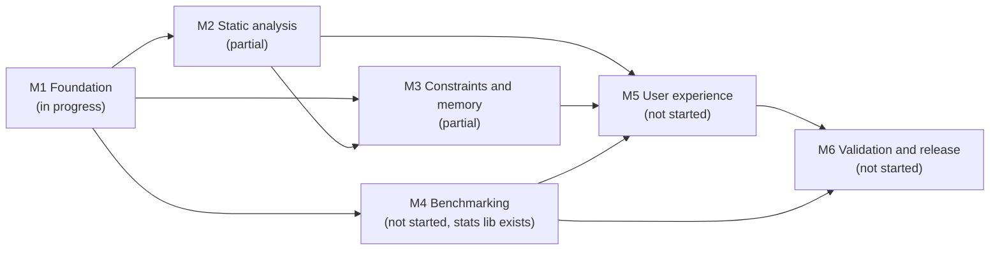

# Roadmap

This document describes the BigO Lens milestones: the goal of each, what it delivers, how we know it is finished, and where it stands. The issue-level breakdown is in [IMPLEMENTATION_PLAN.md](IMPLEMENTATION_PLAN.md), and the product scope is in [DESIGN.md](../../DESIGN.md).

**Current state:** version 0.1.0, protocol 1.0. **M1 Foundation is in progress.** Parts of M2 and M3 exist as early, partial implementations. M4 to M6 have not started, apart from the benchmark statistics library.

Status legend: **Done**, **In progress**, **Partial** (some deliverables exist), **Not started**.

Milestones are ordered by dependency, not by calendar. No dates are promised.

The MVP is **M1–M3 plus M5**. M4 is the first post-MVP feature if it is not ready in time (see [DESIGN.md §8](../../DESIGN.md#8-mvp-scope)).

---

## M1: Foundation

**Status: In progress**

**Goal:** a repository that builds, tests and releases reproducibly on every supported platform, with a stable protocol contract between the engine and the extension.

**Deliverables**

| Deliverable | Status |
| --- | --- |
| Rust workspace architecture ([ADR 0012](docs/architecture/DECISIONS/0012-rust-engine-architecture.md)): root `Cargo.toml`, `crates/bigolens-core` (`#![forbid(unsafe_code)]`), `crates/bigolens-engine` | Done |
| CMake build (C++20, CMake 3.24 or newer) with options `BIGOLENS_ENABLE_CLANG`, `BIGOLENS_BUILD_TESTS`, `BIGOLENS_WARNINGS_AS_ERRORS`, and presets `dev`, `release`, `no-clang`, `ci` | Done |
| Pinned dependencies (nlohmann/json 3.11.3, GoogleTest 1.15.2): `find_package` first, otherwise FetchContent with SHA-256 | Done |
| Core library `bigolens_core`, kept free of Clang | Done |
| `bigolens-engine` CLI: one request in, one response out, with size, depth and source limits | Done |
| JSON protocol 1.0 with JSON Schemas (draft 2020-12) and engine-generated examples | Done |
| VS Code extension scaffold: three commands, tree view, diagnostics, output channel, sidecar constraints, ajv validation, safe spawning | Done (scaffold) |
| Test infrastructure: GoogleTest unit, integration and CLI tests (labelled), and extension unit, integration and smoke tests | Done |
| GitHub Actions: `ci.yml`, `code-quality.yml`, `security.yml`, `release.yml`, plus Dependabot | Authored. **Not yet verified on GitHub** (the repository is not yet published) |
| Engineering, architecture, specification and user documentation | Done (this documentation set) |
| CI green on Linux, macOS and Windows on the published repository | Not started |
| Engine binary bundled into the `.vsix`, so users need no separate build | Not started |
| Branch protection and private vulnerability reporting enabled on GitHub | Not started |

**Exit criteria**

- [ ] The repository is published at `https://github.com/chowdhuryrifat/bigo-lens`, and all required CI jobs pass on `main` for Linux (full), macOS (core) and Windows (core).
- [ ] `release.yml` produced a GitHub Release from a test tag, containing the Linux engine and a `.vsix` that **bundles** the engine. Installing that `.vsix` on a clean Linux machine and running "Analyze Active C++ File" works without setting `bigoLens.enginePath`.
- [ ] Branch protection on `main` (required checks, no force-push) and private vulnerability reporting are enabled.
- [ ] A contributor can follow [CONTRIBUTING.md](../../CONTRIBUTING.md) from a clean Ubuntu machine and get a green `ctest --preset dev` and `npm test`.

---

## M2: Static analysis

**Status: Partial**

**Goal:** sound, explainable structural cost for the loop and recursion shapes that are common in competitive programming, never guessing outside them.

**Deliverables**

| Deliverable | Status |
| --- | --- |
| Clang LibTooling front end (`-fsyntax-only`, in-memory TU, fixed argv), isolated behind `SourceAnalyzer` | Done |
| Counted `for` loops (increasing, decreasing, step `c`), triangular summations, geometric (`*=`, `<<=`, `/=`, `>>=`) and sqrt loops | Done (partial coverage) |
| `while (t--)` test-case loops, linear and logarithmic countdown `while` loops, range-for loops | Done (partial coverage) |
| Status and confidence rules (index written in the body, bound written in the body, user calls, early exit, do-while, data-dependent loops) | Done |
| Direct recursion detection, reported as Unsupported | Done |
| Symbolic expression tree, evaluator and asymptotic derivation | Done |
| Recurrence-solver interface, plus solving for common recurrences (`T(n) = aT(n/b) + f(n)`, `T(n) = T(n-1) + f(n)`) | Not started |
| Interprocedural cost: substituting callee cost for non-recursive user functions | Not started |
| STL cost model applied to calls inside loop nests | Not started (table exists, exposed via `capabilities`) |
| `do-while` and multi-variable `while` loops | Not started (reported as Unsupported or Unknown) |
| Fixtures and near-miss negatives for every supported form | Partial (13 fixtures) |

**Exit criteria**

- [ ] Every loop form listed in [COMPLEXITY_MODEL.md](../specifications/COMPLEXITY_MODEL.md) has a positive fixture and a near-miss fixture, and integration tests assert its pattern, expression, status and confidence.
- [ ] Direct recursion of the supported recurrence shapes produces a time expression with an explicit status. Other recursion stays Unsupported.
- [ ] Calls to supported STL operations contribute their modelled cost, and the finding's `limitations` no longer list them.
- [ ] `capabilities.features` reflects the new maturity levels.

---

## M3: Constraints and memory

**Status: Partial**

**Goal:** turn symbolic cost into worst-case workload and memory figures under the user's actual constraints, using constraint relationships rather than independent maxima.

**Deliverables**

| Deliverable | Status |
| --- | --- |
| Constraint model: variable ranges, sum, product and linear constraints, time and memory limits, all validated | Done |
| Workload by pointwise maxima, with monotonicity checks | Done |
| Sum-constraint packing for superadditive per-case cost, with a sound fallback | Done |
| Using product and linear constraints to tighten bounds | Not started (an assumption in the output says they are unused) |
| Static memory lower bound (globals, static arrays, local arrays) and sized-vector estimates | Done |
| Memory feasibility (HighRisk from lower bounds) | Done |
| Nested containers (`vector<vector<T>>`), `std::string`, maps and sets in the memory estimate | Not started |
| Sidecar constraints file `<file>.bigolens.json` | Done |

**Exit criteria**

- [ ] Product and linear constraints tighten workloads where they apply, with unit tests for sound, fallback and Unknown cases.
- [ ] Memory estimates cover nested vectors and strings, with an explicit status, and never claim a peak.
- [ ] The T/N/ΣN reference example yields 4·10^10 (not 4·10^11), verified end to end through the extension. The engine-level test exists today.

---

## M4: Benchmarking

**Status: Not started** (the `bigolens_benchmark` statistics and growth-fit library exists. Nothing compiles or runs code.)

**Goal:** measure user programs, which must be user-initiated and resource-limited, to obtain a runtime range with explicit uncertainty, and use it for time feasibility and for differential testing of the static analyzer.

**Deliverables**

| Deliverable | Status |
| --- | --- |
| Statistics (median, MAD, relative spread) and growth fitting (Linear, n log n, Quadratic, with an ambiguity rule) | Done |
| Compiler adapter with a fixed argv, compiler discovery and structured compile errors | Not started |
| Input generators driven by the constraints | Not started |
| Runner with timeouts, memory limits, process-tree cleanup and per-run temporary directories | Not started |
| Platform isolation (Linux namespaces, seccomp and rlimits; Windows Job Objects; a macOS strategy) | Not started |
| `benchmark` protocol action (currently `not_implemented`) | Not started |
| Runtime range feeding time feasibility (currently always `unknown`) | Not started |
| Differential tests comparing the predicted growth class with the measured fit | Not started |

**Exit criteria**

- [ ] The threat-model requirements in [THREAT_MODEL.md §4.2](../engineering/THREAT_MODEL.md#42-malicious-benchmark-programs-tb6-planned-m4) are implemented, or the platform is explicitly labelled "not sandboxed" in the UI and documentation.
- [ ] The negative tests for compile errors, timeouts, memory violations and a missing compiler exist and pass.
- [ ] Time feasibility is reported from a measured range with its assumptions.
- [ ] A differential test job runs on demand and is documented.

---

## M5: User experience

**Status: Not started** (the M1 scaffold provides a tree view, diagnostics and navigation)

**Goal:** make results understandable and constraints easy to enter, without leaving the editor.

**Deliverables**

- A constraint form UI that writes the sidecar file
- A webview report with explanations of assumptions and limitations, and charts, under a strict CSP with nonce scripts
- A status-bar summary
- Opt-in re-analysis on save
- Benchmark controls, if M4 is available
- Workspace Trust handling
- Accessibility review: keyboard navigation and screen-reader labels

**Exit criteria**

- [ ] A new user can enter constraints and understand every field of a result without reading the JSON.
- [ ] The webview passes the security requirements in [THREAT_MODEL.md §4.10](../engineering/THREAT_MODEL.md#410-webview-security-tb5-planned-m5).
- [ ] VS Code smoke tests cover the new views and commands.

---

## M6: Validation and release

**Status: Not started**

**Goal:** demonstrate accuracy on a realistic corpus and ship installable artifacts.

**Deliverables**

- A validation corpus of representative solutions, with expected classifications, scored in CI (accuracy is reported, never fabricated)
- Engine binaries for every platform where the Clang front end is supported, bundled into per-platform `.vsix` packages
- Release signing, checksums and provenance
- A decision on, and if taken, the process for Marketplace or Open VSX publication
- Protocol stability review ahead of 1.0

**Exit criteria**

- [ ] Published, reproducible validation results with methodology.
- [ ] Signed release artifacts with checksums.
- [ ] An installation path documented for each supported platform.

---

## Later (post-M6)

These items are unscheduled:

- Problem-statement extraction that produces *candidate* constraints the user must confirm, using offline heuristics, with any LLM use optional and off by default
- A long-lived engine process, or a preamble cache, to reduce header parsing cost
- Multi-file projects
