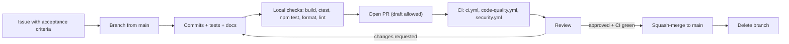

# Git Workflow

BigO Lens uses **trunk-based development** on `main`. This document is the detailed companion to the Git and pull request sections of [RULES.md](../../RULES.md).

## 1. Principles

- `main` is always releasable. It builds and passes CI on every commit.
- Branches are short-lived, ideally merged within a few days. Large features land behind capability flags or as incremental, independently useful pull requests. For example, the benchmark subsystem landed its statistics and growth-fit library before any runner exists, and `capabilities.features.benchmark` still reports `not_implemented`.
- History on `main` is linear. Every pull request is squash-merged into one Conventional Commit.
- **No force-pushes to `main`** and no direct pushes. Branch protection enforces this (see [BRANCH_PROTECTION.md](BRANCH_PROTECTION.md)). All PRs require branch naming conformance, CI verification, and maintainer approval.

## 2. Branches

| Prefix | Use for | Example |
| --- | --- | --- |
| `feat/` | New user-visible capability | `feat/bl-203-recurrence-interface` |
| `fix/` | Bug fix | `fix/triangular-loop-off-by-one` |
| `docs/` | Documentation only | `docs/constraints-file-example` |
| `chore/` | Maintenance, dependency bumps, tooling | `chore/bump-ajv` |
| `refactor/` | Behaviour-preserving restructuring | `refactor/split-loop-classifier` |
| `test/` | Tests only | `test/neg-overflow-fixtures` |
| `ci/` | Workflow changes | `ci/macos-clang-job` |
| `perf/` | Measured performance improvement | `perf/affine-summation-closed-form` |

Rules:

- Use lowercase kebab-case after the prefix. Include the issue ID when there is one.
- Branch from the latest `main`. Rebase onto `main` (do not merge `main` into your branch) to resolve conflicts.
- Force-pushing **your own** feature branch after a rebase is fine. Use `git push --force-with-lease`.
- Delete the branch after merge.
- Dependabot creates its own branches (`dependabot/...`). Review them like any other pull request.

## 3. Commit messages

The format is [Conventional Commits 1.0](https://www.conventionalcommits.org/en/v1.0.0/):

```text
<type>(<scope>): <summary>

<body: what and why, wrapped at 72 columns>

<footers>
```

- **Types:** `feat`, `fix`, `docs`, `test`, `refactor`, `perf`, `build`, `ci`, `chore`, `revert`.
- **Scopes:** `engine`, `frontend` (Clang analyzer), `protocol`, `constraints`, `complexity`, `estimation`, `feasibility`, `benchmark`, `extension`, `build`, `ci`, `docs`.
- **Summary:** imperative mood ("add", not "added"), lowercase after the colon, at most 72 characters, no trailing period.
- **Body:** explain motivation and any change in analysis results. If a fixture's classification changed, say which one and why.
- **Footers:**
  - `Closes #123` or `Refs BL-204`
  - `BREAKING CHANGE: <description>` for a protocol major-version change. Also mark the header with `!`, for example `feat(protocol)!: rename bound_status to certainty`.
  - `Signed-off-by: Name <address>` (DCO) is **optional**. Add it with `git commit -s` if you want to. It is not required to contribute.
  - `Co-authored-by:` for pair or AI-assisted work, where you want attribution.

Examples:

```text
feat(frontend): recognise sqrt loops of the form i*i <= n

Adds trip count sqrt(n) + 1 with bound status Proven when the index is
not written in the body. New fixtures cover the near miss i*i < n*n.

Refs BL-202
```

```text
fix(constraints): do not pack sum constraints over different count variables

Previously two sum constraints with different count variables were
combined, which over-tightened the bound. Such cases now report Unknown.
```

Locally, many small commits are fine. The squash commit title is what must follow the format, so set the pull request title accordingly.

## 4. Pull request flow



1. **Open an issue first** for anything bigger than a typo, so scope and acceptance criteria are agreed before the code is written.
2. **Open the pull request early** as a draft if you want feedback on direction.
3. **The pull request title** is the future squash commit, so it must follow Conventional Commits.
4. **The pull request description** contains:
   - Summary: what changed and why
   - Linked issue
   - Verification: the exact commands you ran and their outcome (for example `ctest --preset dev`, or `npm test` in `extension/`). Only list what you actually ran.
   - Analysis impact: any change in findings, statuses or workloads for existing fixtures
   - Protocol impact: none, minor or major, with the schema, docs and example updates
   - Screenshots for extension UI changes
5. **CI must be green.** The experimental macOS Clang job is allowed to fail and does not block merge.
6. **Mark review conversations resolved** only when they are addressed.

## 5. Review

- At least **one approving review** from someone other than the author. Protocol major changes, security-relevant changes (process spawning, file system access, sandboxing, workflows) and new dependencies need a maintainer's approval.
- Reviewers apply the priority order in [ENGINEERING_RULES.md §2.3](ENGINEERING_RULES.md#23-review-standards): honesty of results, security, protocol compatibility, tests, design, style.
- Reviewers should check out the branch and run the relevant tests for non-trivial analysis changes, not just read the diff.
- Use the prefixes "nit:" for optional suggestions and "blocking:" for required changes.
- The author merges after approval unless they ask the reviewer to merge.

## 6. Releases

- Versions follow [SemVer](https://semver.org/). While the version is `0.x`, minor releases may contain breaking changes to the C++ APIs. Protocol compatibility is versioned separately through `schema_version` (see [JSON_PROTOCOL.md](../specifications/JSON_PROTOCOL.md)).
- The version is declared in **two places**, which must agree: `project(... VERSION X.Y.Z)` in the root `CMakeLists.txt` and `"version"` in `extension/package.json`.
- Release procedure:
  1. Open a `chore(release): vX.Y.Z` pull request that bumps both versions and updates the changelog.
  2. After it merges, create an annotated tag on that commit: `git tag -a vX.Y.Z -m "BigO Lens vX.Y.Z"` and `git push origin vX.Y.Z`.
  3. `release.yml` runs on tags matching `v*.*.*`. It checks that the tag matches both versions, builds and tests, packages the Linux engine and the `.vsix`, and creates a GitHub Release with those artifacts.
  4. Marketplace publishing is **not** automated and has not happened yet.
- Tags are immutable. Never move or delete a published tag. Fix a bad release with a new patch version.

## 7. Things not to do

- Force-push to `main`, or rewrite published history.
- Merge with red CI. "It is flaky" needs an issue and a fix, not a re-run until it passes.
- Mix unrelated changes, such as reformatting the whole codebase alongside a fix.
- Commit generated files (`build/`, `extension/out/`, `extension/schemas/`, `*.vsix`), secrets or personal configuration.
- Commit with `--no-verify` to bypass local hooks that a contributor has set up.
