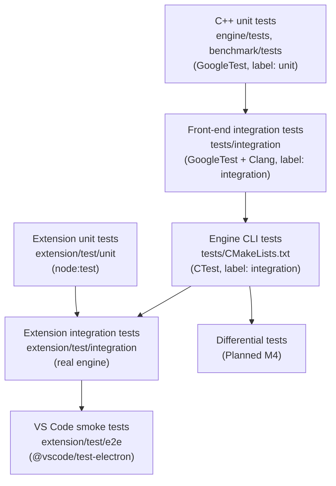

# Testing Strategy

This document describes how BigO Lens is tested: what each layer covers, where its tests live, how to run them, and which kinds of tests do not exist yet. The rules that every test must follow are in [RULES.md §11](../../RULES.md#11-testing) and [ENGINEERING_RULES.md §5](ENGINEERING_RULES.md#5-testing-standards).

Status words in this document: **Exists** means the tests are in the repository today. **Planned (Mx)** means they are scheduled for a milestone in [ROADMAP.md](../development/ROADMAP.md).

## 1. Goals

1. **Correct classification.** Every supported loop or recursion pattern is classified with the right expression, `bound_status` and `confidence`, and unsupported shapes are *not* given a guessed complexity.
2. **Sound workloads.** Constraint evaluation never reports a bound smaller than the true structural worst case for the stated status.
3. **Robust boundaries.** Malformed, oversized or hostile input yields a structured error, never a crash, hang or stdout pollution.
4. **Stable contract.** Engine responses always validate against `shared/schemas/response.schema.json`, and the extension rejects anything that does not.
5. **Deterministic CI.** The same commit gives the same result on every run.

## 2. Test layers



### 2.1 C++ unit tests (Exists)

These use GoogleTest 1.15.2 and are discovered by `gtest_discover_tests` with the CTest label `unit`. They do not need Clang and run on Linux, macOS and Windows.

| Executable | Files | Covers |
| --- | --- | --- |
| `bigolens_engine_tests` | `engine/tests/expression_test.cpp` | Factory simplification, free variables, invalid power and logarithm rejected, rendering of every node kind |
| | `evaluator_test.cpp` | Arithmetic, unbound variables, triangular summation equal to the closed form, empty summation, log clamp, overflow reported, budget respected, maximum |
| | `asymptotic_test.cpp` | O(1), O(n), O(log n), O(n log n), products, dominated terms dropped, incomparable terms kept, triangular summation giving O(n^2) |
| | `constraints_test.cpp` | Valid sets, inverted ranges, sum constraints needing declared bounds, product and linear constraints referencing declared variables, magnitude limit |
| | `workload_test.cpp` | Pointwise maxima, missing bounds giving Unknown, sum-constraint packing (`t·n²` with Σn ≤ 2·10^5 gives 4·10^10), non-monotone expressions giving Estimated, superadditivity recognition |
| | `memory_estimator_test.cpp` | Static storage summed and proven, saturation instead of overflow, vector buffers at constraint maxima, unbounded vector giving an unknown minimum, largest local array |
| | `feasibility_test.cpp` | Time Unknown without an estimate, the time classification policy, memory HighRisk from static storage, memory never LikelySafe from lower bounds alone |
| | `stl_cost_model_test.cpp` | `unordered_map` average versus worst case, amortized `push_back`, `sort` O(n log n), required entries present |
| | `protocol_test.cpp` | Request validation and every error code reachable without Clang (see §5) |
| `bigolens_benchmark_tests` | `benchmark/tests/statistics_test.cpp` | Median and MAD for odd and even counts, outlier robustness, invalid samples rejected |
| | `benchmark/tests/growth_fit_test.cpp` | Linear, n log n and quadratic data selected correctly, constant data ambiguous, too few or invalid points rejected |

### 2.2 Front-end integration tests (Exists, Linux with Clang)

`tests/integration/frontend_pipeline_test.cpp` (`bigolens_integration_tests`, label `integration`) runs the full path: C++ source, Clang AST, static analysis, constraint evaluation and the JSON response. It is built only when `BIGOLENS_ENABLE_CLANG=ON`, and it reads fixtures through the `BIGOLENS_FIXTURE_DIR` compile definition (no hardcoded paths).

### 2.3 Engine CLI tests (Exists)

These are defined in `tests/CMakeLists.txt` with the label `integration`. They drive the `bigolens-engine` executable with `--request <file>` using the files in `shared/examples/`, exactly as a client would, and match the output against a pass pattern:

| Test | Input | Expects |
| --- | --- | --- |
| `engine_cli.capabilities` | `capabilities.request.json` | `"status":"ok"` |
| `engine_cli.benchmark_not_implemented` | `benchmark.request.json` | `"code":"not_implemented"` |
| `engine_cli.invalid_request` | `invalid.request.json` | `"code":"invalid_request"` |
| `engine_cli.malformed_json` | `malformed.request.txt` | `"code":"malformed_json"` |
| `engine_cli.analyze` (with Clang) | `analyze.request.json` | `"method":"sum-constraint-packing"` |
| `engine_cli.analyze_without_frontend` (without Clang) | `analyze.request.json` | `"code":"frontend_unavailable"` |
| `engine_cli.version` | `--version` | `bigolens-engine X.Y.Z` |
| `engine_cli.unknown_argument` | an unknown flag | non-zero exit (`WILL_FAIL`) |

### 2.4 Extension tests (Exists)

| Suite | Command | Needs | Covers |
| --- | --- | --- | --- |
| Unit | `npm test` | Node 22 | Engine locator order, sidecar constraint parsing and validation, request building, response schema validation, engine client against a fake engine script |
| Integration | `npm run test:integration` | A built engine, auto-detected in `build/dev` or set through `BIGOLENS_ENGINE_PATH` | Real engine round trip. **Skips with a message** when no engine is found |
| VS Code smoke | `npm run test:vscode` | Downloads VS Code; needs a display (`xvfb-run` on Linux) | Activation and command registration in a real extension host |
| Schema validation | `npm run validate:schemas` | Node 22 | Schemas compile, and `shared/examples` validate against them |

CI runs all four on Linux. The smoke test runs under xvfb, and the integration test runs against an engine built in the same job.

### 2.5 Differential tests (Planned M4)

Differential tests compare the growth class that static analysis **predicts** with the growth class **measured** for a controlled program. They exist to catch analyzer bugs that unit tests miss.

Planned design (see [BENCHMARK_SPECIFICATION.md](../specifications/BENCHMARK_SPECIFICATION.md)):

1. A curated set of controlled programs, built from the fixtures in `tests/fixtures/cpp/`, with input generators that sweep `n` over at least 4 distinct sizes.
2. Each program is compiled and run by the M4 benchmark runner, inside the M4 sandbox.
3. `bigolens::benchmark::fitGrowth` fits Linear, Linearithmic and Quadratic models.
4. The test **passes** when the selected model equals the asymptotic class predicted by static analysis, or when the fit is `ambiguous` (an ambiguous fit is recorded, not counted as a failure). It **fails** on a confident disagreement.
5. These tests run in a separate, non-blocking CI job, or on demand, because timing depends on the machine. They compare growth *classes*, never absolute times.

Only the fitting and statistics library exists today, together with its unit tests. Nothing in the repository compiles or runs fixture programs.

## 3. Regression fixtures (`tests/fixtures/cpp/`)

Each fixture is a small, self-contained C++ program. Every new pattern or bug fix adds one.

| Fixture | Exercises | Expected classification (asserted in `frontend_pipeline_test.cpp`) |
| --- | --- | --- |
| `01_linear_loop.cpp` | `for (i = 0; i < n; ++i)` | `linear-loop`, Proven, O(n), workload 1000 for n ≤ 1000 |
| `02_nested_loops.cpp` | Independent nested loops over `n` and `m` | `nested-loop`, O(m n), workload 30000 for n ≤ 100, m ≤ 300 |
| `03_triangular_loop.cpp` | `for j < i` inside `for i < n` | `triangular-loop`, Proven, O(n^2), exact count n(n-1)/2 |
| `04_logarithmic_loop.cpp` | Doubling index `i *= 2` | `logarithmic-loop`, O(log n), workload 11 for n ≤ 1024 |
| `05_sorting.cpp` | Input loop, `std::vector`, `std::sort` | Linear input loop O(n); top-level `std::sort` O(n log n); `dynamic_allocation` with space expression `4 * n`, Estimated |
| `06_binary_search.cpp` | `while (lo < hi)` | Second loop is `data-dependent-loop`, Unknown, confidence `none`, `time` null. It is **not** guessed as O(log n) |
| `07_naive_fibonacci.cpp` | Two self-calls in `fib` | `multiple-direct-recursion`, Unsupported, `time` null |
| `08_linear_space_vector.cpp` | Sized `std::vector` and a static array | Vector space O(n) (Estimated); static array 4000 bytes (Proven) |
| `09_sum_constrained_test_cases.cpp` | `while (t--)` with per-case O(n^2) work | `test-case-loop`, `sum-constraint-packing`, workload 4·10^10 |
| `10_data_dependent_termination.cpp` | Collatz iteration | `data-dependent-loop`, Unknown |
| `sequential_loops.cpp` | Sibling inner loops | Costs summed: O(m n + n^2) |
| `neg_invalid_syntax.cpp` | Syntax error | `source_parse_error`, error diagnostics with locations, `results` null |
| `neg_modified_index.cpp` | Loop index written in the body | Unsupported, `time` null |

The integration suite also checks that missing constraints leave the workload Unknown, and that the front-end version is reported.

### 3.1 Loop-form coverage (`tests/fixtures/cpp/forms/`, BL-201)

Every supported form in [COMPLEXITY_MODEL.md §2](../specifications/COMPLEXITY_MODEL.md#2-supported-loop-forms)
and every status rule in §3 has a positive case and at least one near miss. `tests/integration/loop_forms_test.cpp`
is table-driven. For each finding, in source order, it asserts the function, the pattern, the exact time
expression (or that none is reported), the bound status, the confidence and the leading limitation. It also checks
the invariant "no expression ⇒ unknown/unsupported with confidence none". The fixtures include no standard headers,
so the suite is fast and does not depend on the installed C++ library.

| Form | Fixture | Positive cases (expression) | Near misses (expected result) |
| --- | --- | --- | --- |
| L1 `i < b`, `++i`/`i++`, assignment init, `!=` unit step | `L01_increasing_unit_step.cpp` | `n`; start 2 → `n - 2`; reversed comparison `n > i` | `!=` with stride (unknown); index written (unsupported); bound written (estimated, low); `double` index (unsupported); bound read from an array (unknown) |
| L2 `i <= b` | `L02_increasing_inclusive.cpp` | `1..n` → `n` | increasing index with `>=` (unknown) |
| L3 `i += c` | `L03_constant_stride.cpp` | `0.333333 * (n - 1) + 1`, `0.25 * n + 1` | variable step, zero step (unknown) |
| L4 `i > b`, `--i`, `!=` | `L04_decreasing_exclusive.cpp` | `n` | variable decrement, `<` with a decreasing index (unknown) |
| L5 `i >= b`, `i -= c` | `L05_decreasing_inclusive.cpp` | `n + 1`, `0.5 * (n - 1) + 1` | unsigned `>= 0` (unsupported) |
| L6 `i *= c`, `i <<= k` | `L06_geometric_growth.cpp` | `log_2(n) + 1`, `log_3(n) + 1`, `log_4(n) + 1` | start 0, variable start (unknown) |
| L7 `i /= c`, `i >>= k` | `L07_geometric_decay.cpp` | `log_2(n) + 1`, `log_10(n) + 1` | stop at `i > 1` (unknown) |
| L8 `i * i <= n` | `L08_square_root.cpp` | `n^0.5 + 1` (early return gives confidence medium) | stride 2 (unknown) |
| L9 `while (t--)`, `while (t-- > 0)` | `L09_test_case_loop.cpp` | `t * n`, `t` | counter written (unsupported); `while (--t)` (unknown) |
| L10 countdown `while` | `L10_countdown_while.cpp` | `x` for `> 0`, truthy, `!= 0`, `>= 1` | two updates, conditional update (unknown) |
| L11 halving `while` | `L11_halving_while.cpp` | `log_2(x) + 1`; unbraced body `log_10(x) + 1` | `x /= 1`, `x = x / 2` (unknown) |
| L12 range-for over a named container | `L12_range_for_container.cpp` | `v.size()` (user-defined container, Proven) | temporary range; element used as an inner bound (unknown) |
| L13 range-for over a constant array | `L13_range_for_array.cpp` | `16`, `8` | — (no meaningful near miss: every array range has a constant size) |
| L14 two-pointer `while (l < r)` (BL-206) | `L14_two_pointer.cpp` | `n`, `n - 1`, `r - l`, symmetric `r > l`, early exit | one path updates neither (unknown); both updated on path (unknown); arbitrary assignment (unknown) |
| Composition (§2.1) | `C01_nesting_and_dependence.cpp` | lower/upper triangles as summations, sequential inner loops `n * (n + m)`, nested log `n * (log_2(n) + 1)` | strided dependent outer loop; one unknown inner loop (unknown nest) |
| Status rules (§3) | `C02_status_rules.cpp` | user call (estimated, low); library call (proven, medium); early exit (proven, medium); direct recursion (unsupported) | `do-while` (unsupported); `for (;;)` (unknown) |
| Interprocedural (BL-204) | `I01_interprocedural.cpp` | loop calling O(m) helper → O(m n); chained helpers → O(k n); index passing → O(n^2) summation | helper with unknown loop → unknown; recursive helper → estimated, low; mutual call cycle → estimated, low |
| STL cost model (BL-205) | `S01_stl_cost.cpp` | set insert in loop O(n log n); map lookup O(n log m); priority queue push O(n log n); vector push_back amortized O(n); vector erase O(n^2); lower_bound O(n log n); sort in loop O(m n log n); top-level sort O(n log n) | unordered_map find with average O(n) vs worst linear (estimated, low) |

## 4. Determinism

- No assertions depend on wall-clock time, CPU speed, thread scheduling or the current date.
- No network access in tests. CMake dependencies are resolved at configure time, and npm packages at `npm ci`.
- Fixtures are found through compile definitions (`BIGOLENS_FIXTURE_DIR`) or paths relative to the repository, never absolute machine paths.
- Findings are ordered by source position (IDs `F1`, `F2`, and so on), so their order in the output is stable.
- The expression evaluator is deterministic IEEE double arithmetic. Tests use exact comparisons only where the value is exactly representable (`EXPECT_DOUBLE_EQ(…, 4e10)`), and tolerances otherwise.
- Example responses in `shared/examples/*.response.json` are regenerated by running the real engine (`scripts/development/regenerate-examples.sh`). A diff in them during review means behaviour changed.
- **No performance thresholds in ordinary CI.** Shared CI runners are noisy. Performance is measured separately (see [PERFORMANCE.md](PERFORMANCE.md)).

## 5. Negative test matrix

| Scenario | Expected behaviour | Status | Where |
| --- | --- | --- | --- |
| Invalid source (syntax error) | `source_parse_error` with compiler diagnostics; analysis not run | **Exists** | `neg_invalid_syntax.cpp`, `InvalidSourceReportsDiagnosticsAndNoFindings` |
| Unsupported syntax: modified index | Finding with `unsupported` status, confidence `none` | **Exists** | `neg_modified_index.cpp`, `ModifiedIndexIsUnsupported` |
| Unsupported: recursion | `unsupported`, no time expression | **Exists** | `07_naive_fibonacci.cpp` |
| Unsupported: data-dependent termination | `unknown`, not guessed | **Exists** | `06_binary_search.cpp`, `10_data_dependent_termination.cpp` |
| Unsupported: `do-while` | `unsupported` | **Exists** | `forms/C02_status_rules.cpp` (`do_while`) |
| Numeric overflow in evaluation | `Overflow` status, never a non-finite number | **Exists** | `Evaluator.OverflowIsReportedNotReturned` |
| Memory total overflow | Saturates and sets `static_storage_saturated` | **Exists** | `MemoryEstimator.StaticStorageSaturatesInsteadOfOverflowing` |
| Constraint magnitude above 10^18 or out of range | `invalid_request` with a path | **Exists** | `ConstraintValidation.MagnitudeLimitIsEnforced`, `Protocol.ConstraintValuesAreRangeChecked` |
| Missing constraints | Workload `unknown` with `missing_bounds` | **Exists** | `Workload.MissingBoundGivesUnknown`, `MissingConstraintsLeaveWorkloadUnknown` |
| Inconsistent constraints (inverted range, undeclared variable) | `invalid_request` | **Exists** | `constraints_test.cpp`, `Protocol.SumConstraintWithoutBoundsIsRejected` |
| Malformed JSON | `malformed_json` | **Exists** | `Protocol.MalformedJsonIsAStructuredError`, `engine_cli.malformed_json` |
| Excessive nesting | Rejected before parsing | **Exists** | `Protocol.ExcessiveNestingIsRejectedBeforeParsing` |
| Oversized request | `request_too_large` | **Exists** | `Protocol.OversizedRequestIsRejected` |
| Unknown fields, bad `request_id`, wrong language, incompatible schema version | `invalid_request` / `unsupported_schema_version` | **Exists** | `protocol_test.cpp` |
| Missing inputs (no `source` for analyze) | `invalid_request` | **Exists** | `Protocol.AnalyzeRequiresSource` |
| Unknown CLI argument | Exit code 2 and usage on stderr | **Exists** | `engine_cli.unknown_argument` |
| Missing front end ("missing compiler" for static analysis) | `frontend_unavailable` | **Exists** | `Protocol.AnalyzeWithoutFrontendReportsUnavailable`, `engine_cli.analyze_without_frontend` |
| Malformed engine response (extension side) | Rejected by ajv and reported | **Exists** | extension unit tests (response validation) |
| Engine executable not found (extension side) | Actionable error naming the settings to check | **Exists** | extension unit tests (engine locator) |
| Engine timeout (extension side) | Process killed, `timeout` error reported | **Exists** | `extension/test/unit/engineClient.test.ts` ("kills an engine that exceeds the timeout", fake engine in `extension/test/fixtures/fake-engine.mjs`) |
| Benchmark compile errors | Structured compile error from the compiler adapter | **Exists** | `compiler::tests::test_compile_success_and_error_with_system_compiler` |
| Benchmark timeouts | Process tree killed, `timeout` result | **Exists** | `runner::tests::test_infinite_loop_killed_at_timeout` |
| Benchmark memory-limit violations | Run terminated, `memory_limit_exceeded` | **Exists** | `runner::tests::test_memory_limit_exceeded` |
| Missing compiler for benchmarks | Structured error naming the compiler searched for | **Exists** | `compiler::tests::test_missing_compiler_returns_structured_error` |
| Benchmark sandbox escape attempts (file or network access) | Denied by isolation | **Exists** | `runner::tests::test_sandbox_denies_reading_home_files`, `runner::tests::test_sandbox_denies_socket_creation`, `runner::tests::test_sandbox_denies_execve` |

## 6. Running tests

```bash
# Native: full build with the Clang front end (Linux)
cmake --preset dev
cmake --build --preset dev
ctest --preset dev

# Native: core only (any platform, no Clang needed)
cmake --preset no-clang && cmake --build --preset no-clang && ctest --preset no-clang

# Select by label
ctest --preset dev -L unit
ctest --preset dev -L integration

# Extension
cd extension
npm ci && npm run compile && npm run lint && npm test
npm run test:integration   # needs a built engine
npm run test:vscode        # downloads VS Code; use xvfb-run on headless Linux
npm run validate:schemas

# Everything the scripts know how to run
scripts/test/run-all-tests.sh
```

## 7. Adding tests: checklist

- [ ] A new loop or recursion pattern has a positive fixture, a near-miss fixture and integration assertions on its pattern, expression, status and confidence.
- [ ] A new constraint or workload rule has unit tests for its sound case, its fallback case and its Unknown case.
- [ ] A new protocol field or error code has a validation test, an updated schema and a regenerated example.
- [ ] A new extension behaviour has a unit test that runs without VS Code. UI wiring is covered by the smoke test.
- [ ] No timing assertions, no network and no absolute paths.
