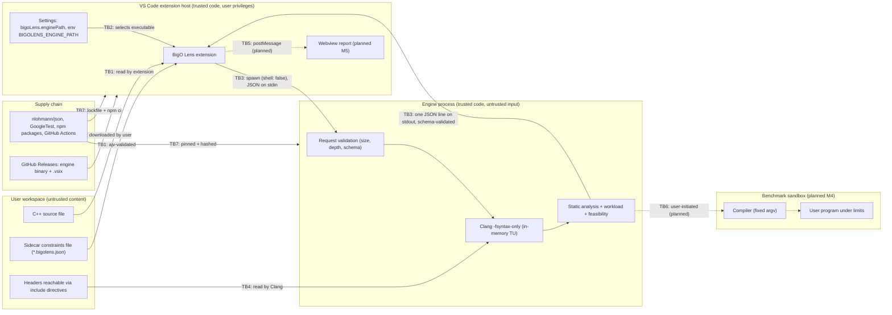

# Threat Model

This document identifies what BigO Lens must protect, where trust changes hands, and how each threat is mitigated. Every mitigation is labelled **Implemented**, **Partial** or **Planned (Mx)**. Planned mitigations are requirements for future work, not current guarantees.

Reporting process: [SECURITY.md](../../SECURITY.md). Benchmark design: [BENCHMARK_SPECIFICATION.md](../specifications/BENCHMARK_SPECIFICATION.md).

## 1. System summary and security posture today

- The **VS Code extension** (TypeScript) reads the active C++ file and an optional sidecar constraints file (`<file>.bigolens.json`). It spawns the **engine** and exchanges one JSON request and one JSON response over stdin and stdout.
- The **engine** (`bigolens-engine`, C++20) validates the request and parses the source with Clang LibTooling in `-fsyntax-only` mode, from an in-memory buffer. It then runs static analysis and returns findings.
- **The engine never compiles to object code, links or executes user code.** The `benchmark` action returns `not_implemented`. The benchmark library that exists today (`bigolens_benchmark`) only does statistics and curve fitting on numbers passed to it.
- Like any compiler front end, Clang **reads the headers named in `#include` directives** from the user's file system, using its normal search paths.

Most "code execution" threats therefore apply only to the planned M4 benchmark runner, and are recorded here so that M4 is designed against them.

## 2. Assets

| ID | Asset | Why it matters |
| --- | --- | --- |
| A1 | The user's machine: files, credentials, network identity | A local developer tool runs with the user's full privileges |
| A2 | The user's source code and constraints | May be private (contest solutions, proprietary code) |
| A3 | Integrity of analysis results | Users make decisions (submit, rewrite) based on them, and wrong certainty is harmful |
| A4 | Availability of the editor | A hung or runaway engine degrades VS Code |
| A5 | The project's supply chain: repository, CI, release artifacts | A compromised release would run on every user's machine |
| A6 | CI secrets and tokens | Could be used to tamper with releases |

## 3. Trust boundaries

| Boundary | From → To | Crossing data |
| --- | --- | --- |
| TB1 | Workspace → extension | Source text, sidecar JSON |
| TB2 | Settings and environment → extension | Engine executable path |
| TB3 | Extension ↔ engine process | JSON request on stdin, JSON response on stdout, stderr text |
| TB4 | File system → Clang | Included headers |
| TB5 | Extension ↔ webview (planned) | Rendered results, user actions |
| TB6 | Engine → compiler and user program (planned M4) | Source, argv, generated inputs, measurements |
| TB7 | Upstream dependencies → build | Source archives, npm packages, CI actions |
| TB8 | Release artifacts → users | Engine binary, `.vsix` |

## 4. Threats and mitigations

STRIDE categories: **S**poofing, **T**ampering, **R**epudiation, **I**nformation disclosure, **D**enial of service, **E**levation of privilege.

### 4.1 Untrusted source code (TB1, TB3, TB4)

| Threat | STRIDE | Mitigation | Status |
| --- | --- | --- | --- |
| Source crafted to crash the parser or analyzer | D | Clang is a hardened, widely fuzzed front end. Analysis never runs on an AST with errors. `RequestHandler` converts exceptions into `internal_error` | Implemented |
| Pathological source causing huge ASTs or deep recursion | D | Source limited to 2 MiB and the request to 4 MiB. The extension enforces a timeout (`bigoLens.analysisTimeoutMs`, default 30 s) and kills the engine | Implemented |
| Source that floods diagnostics | D | At most 50 error diagnostics are collected, and warnings are suppressed | Implemented |
| `#include` of sensitive files (for example `#include "/etc/shadow"`) to leak contents | I | The engine reads headers as a compiler would, but returns only diagnostics and findings, never file contents. Diagnostic messages could quote a fragment of the included text in an error. The output goes only to the local user who already has that access | Accepted risk (local, same user) |
| `#include` of a device or FIFO (`/dev/zero`, `/dev/stdin`) to hang the parser | D | The extension timeout kills the engine. Restricting include paths to regular files is not implemented | Partial |
| Source triggering exponential template instantiation | D | Extension timeout. Clang's own instantiation depth limits apply | Partial |
| Analysis results that falsely claim certainty | T (of A3) | Bound status and confidence rules. Unknown shapes are reported as `unknown` or `unsupported`. Fixture tests cover the near misses | Implemented (partial analyzer coverage) |

### 4.2 Malicious benchmark programs (TB6, Planned M4)

Benchmarking would compile and **execute** user code. That code may be hostile, for example a solution copied from an untrusted source, or a workspace opened from a malicious repository.

| Threat | STRIDE | Required mitigation | Status |
| --- | --- | --- | --- |
| Program reads or writes user files, or exfiltrates over the network | I, T, E | Platform isolation. Linux: separate user, mount and network namespaces where available, seccomp filter, rlimits (`RLIMIT_AS`, `RLIMIT_CPU`, `RLIMIT_NPROC`, `RLIMIT_FSIZE`, `RLIMIT_NOFILE`). Windows: Job Objects with restricted tokens. macOS: `sandbox-exec` is deprecated, so a supported alternative must be found or benchmarking marked unsupported there | Planned (M4) |
| Fork bomb or runaway child processes | D | Process-group or Job Object tracking with kill-tree on every exit path, plus `RLIMIT_NPROC` | Planned (M4) |
| Infinite loop | D | Wall-clock and CPU timeouts, then forced termination | Planned (M4) |
| Memory exhaustion | D | Address-space or Job memory limits, with the measured peak reported | Planned (M4) |
| Disk filling | D | `RLIMIT_FSIZE` and a per-run temporary directory with a quota where available | Planned (M4) |
| Benchmarking started without the user's knowledge | E | Benchmarks are user-initiated only, with an explicit command and confirmation. They never run on file open or save | Planned (M4) requirement |
| Users believing a timeout is a sandbox | I | **A timeout alone is not a sandbox.** Until isolation is implemented for a platform, the UI and documentation must state that benchmarking there is **not sandboxed** | Planned (M4) requirement |

### 4.3 Compiler argument injection (TB3, TB6)

| Threat | STRIDE | Mitigation | Status |
| --- | --- | --- | --- |
| A request field smuggles compiler flags (`-Xclang -load`, `-fplugin=`, `-include /etc/passwd`, `-o /path`) | E, I | The Clang front end uses a **fixed argument list**. The only request-derived value is `options.cpp_standard`, validated against the enum `c++11 … c++23` before use. Unknown request fields are rejected | Implemented |
| A future benchmark compiler invocation takes flags from the user | E | The compiler is invoked with a fixed argv. Optimization level and standard come from validated enums, and free-form flags are never accepted | Planned (M4) requirement |
| A source path used as an option (a file named `-fplugin=x.so`) | E | Source is passed as an in-memory buffer under a display name, not as a path argument. A future compiler adapter must place `--` before file operands | Implemented (front end); Planned (M4) |

### 4.4 Shell injection and process spawning (TB2, TB3)

| Threat | STRIDE | Mitigation | Status |
| --- | --- | --- | --- |
| Shell metacharacters in the engine path or file names executed by a shell | E | The extension spawns the engine with `child_process.spawn(path, [], { shell: false })`. No arguments are passed, and the request travels over stdin | Implemented |
| A malicious workspace sets `bigoLens.enginePath` to an attacker binary | E, S | The setting has scope `machine`, so VS Code ignores it in workspace and folder settings; only user (machine) settings and the `BIGOLENS_ENGINE_PATH` environment variable can select a different executable. Planned: declare Workspace Trust support (`capabilities.untrustedWorkspaces`) as defence in depth | Mitigated (setting scope); Workspace Trust planned M5 |
| `BIGOLENS_ENGINE_PATH` or the development-build fallback picks up an unexpected binary | S | The search order is documented. The engine identity is checked via `engine.name` and `protocol_version` in every response. There is no signature verification | Partial |
| The engine uses `system()` or `popen()` | E | Prohibited by [RULES.md §16](../../RULES.md#16-prohibited-practices). The engine spawns no processes today | Implemented (no spawning) |

### 4.5 Path traversal (TB1, TB6)

| Threat | STRIDE | Mitigation | Status |
| --- | --- | --- | --- |
| `source.path` in a request used to read or write arbitrary files | T, I | The engine treats `source.path` as a **display name only**. The content comes from `source.content`, and the engine writes no files | Implemented |
| The sidecar file location is manipulated | T | The sidecar path is derived from the active document's path (`<file>.bigolens.json`), not from file content | Implemented |
| Future benchmark artifacts written outside their temporary directory | T | Generated names, never user-controlled names. Paths canonicalized and checked against the run directory | Planned (M4) |

### 4.6 Temporary directories (TB6)

| Threat | STRIDE | Mitigation | Status |
| --- | --- | --- | --- |
| Predictable temporary names enabling symlink or race attacks | T, E | Use `mkdtemp` or the platform equivalent (mode 0700) per run. Never reuse a directory | Planned (M4). No temporary files are created today |
| Leftover binaries or inputs after a crash | I, D | RAII cleanup on every path, plus cleanup of stale directories carrying a BigO Lens prefix on start-up | Planned (M4) |

### 4.7 Resource exhaustion (TB3)

| Threat | STRIDE | Mitigation | Status |
| --- | --- | --- | --- |
| Huge request | D | Limited to 4 MiB (`request_too_large`), with reads bounded in `main.cpp` | Implemented |
| Deeply nested JSON overflowing the recursive parser | D | Depth limited to 64, **checked before parsing** (reported as `malformed_json`) | Implemented |
| Huge constraint values causing overflow | D, T | Magnitude at most 10^18. The evaluator reports non-finite values as `Overflow`, and memory sums saturate | Implemented |
| Non-affine summations with enormous ranges | D | Evaluator budget of 5×10^7 node evaluations by default, then Unknown or approximate | Implemented |
| Engine writes unbounded stdout | D | The extension caps stdout at 16 MiB and kills the process beyond it | Implemented |
| Engine hangs | D | Extension timeout and kill | Implemented |

### 4.8 Malformed JSON (TB1, TB3)

| Threat | STRIDE | Mitigation | Status |
| --- | --- | --- | --- |
| Invalid request JSON | D | `malformed_json` structured error, no crash | Implemented |
| Schema-valid but semantically hostile values | T | Strict validation: unknown fields rejected, `request_id` pattern `[A-Za-z0-9_.:-]{1,128}`, enums checked, ranges checked, identifiers at most 64 characters | Implemented |
| Malformed or hostile engine response (a buggy or replaced engine) | T, E | The extension validates every response with ajv against `response.schema.json` before use | Implemented |
| Malformed sidecar constraints | T | Validated with ajv against the `constraints` sub-schema, with errors reported to the user | Implemented |

### 4.9 Dependency compromise (TB7, TB8)

| Threat | STRIDE | Mitigation | Status |
| --- | --- | --- | --- |
| Tampered C++ dependency archive | T | FetchContent downloads pinned release URLs verified by **SHA-256**. A system `find_package` is preferred when available | Implemented |
| Malicious npm package or update | T, E | `package-lock.json` with `npm ci`, `npm audit` in `security.yml`, Dependabot (weekly), and dependency review on pull requests | Implemented |
| Compromised GitHub Action | T, E | Only official actions, pinned to major versions, with `permissions: contents: read` by default. Pinning to commit SHAs is a possible hardening step | Partial |
| Static-analysis gaps in our own code | T | CodeQL for C/C++ and JavaScript/TypeScript | Implemented |
| Tampered release artifacts | T, S | Artifacts are built by `release.yml` from the tagged commit. Signing, checksums and provenance attestations are not implemented | Planned |
| Leaked CI secrets | I | No secrets are required for CI today. Release jobs use the scoped `GITHUB_TOKEN`. Secrets must never be printed | Implemented |

### 4.10 Webview security (TB5, Planned M5)

No webview exists today. When the M5 report view is built, it must meet these requirements:

| Requirement | Purpose |
| --- | --- |
| Strict Content Security Policy: `default-src 'none'`, scripts only with a per-load **nonce**, styles from the extension's own resources, no `unsafe-eval` and no `unsafe-inline` scripts | Prevents script injection from analysed content |
| `localResourceRoots` limited to the extension's media directory | Prevents reading workspace files from the webview |
| All analysis text (function names, messages, expressions) inserted as **text**, never as HTML | Source identifiers are attacker-controlled |
| Every `postMessage` from the webview validated against an explicit message schema | The webview is a less-trusted context |
| No remote resources (CDNs or fonts) | Offline use and privacy |

### 4.11 External input validation: summary

| Input | Validated by | Rules |
| --- | --- | --- |
| Engine request | `api::parseRequest` (C++) | Size, depth, schema version, closed field sets, types, ranges, identifier syntax |
| Engine response | ajv in the extension | `response.schema.json` |
| Sidecar constraints file | ajv in the extension, then the engine again | `constraints` schema, re-validated by the engine |
| VS Code settings | VS Code schema in `package.json` | Enum for `cppStandard`, range 1000–600000 for `analysisTimeoutMs` |
| Environment (`BIGOLENS_ENGINE_PATH`, `BIGOLENS_CLANG_RESOURCE_DIR`) | Existence checks only | Treated as trusted user configuration |
| Benchmark inputs and sizes (M4) | To be specified | Bounded sizes, generated by the engine, never from free-form shell commands |

## 5. Repudiation and logging

BigO Lens is a local tool and does not keep audit logs. Requests carry a `request_id` that is echoed in the response, and the extension logs request IDs and error codes to the `BigO Lens` output channel. Source content is never logged.

## 6. Residual risks

1. Clang reads any header the source includes. A user who analyses untrusted code on a machine with sensitive readable files accepts the same exposure as when compiling that code.
2. Engine-binary resolution trusts the user's settings and environment, including workspace-level settings (see §4.4).
3. Until M4 isolation exists, there is no safe way to run user programs, so the feature is not implemented.
4. Release artifacts are not signed.

## 7. Review triggers

Update this document in the same pull request when a change:

- spawns a process or adds a new process boundary
- reads or writes files, or creates temporary directories
- adds a request field that influences compiler or process arguments
- adds a webview, network access or a new dependency
- changes CI permissions or release packaging
